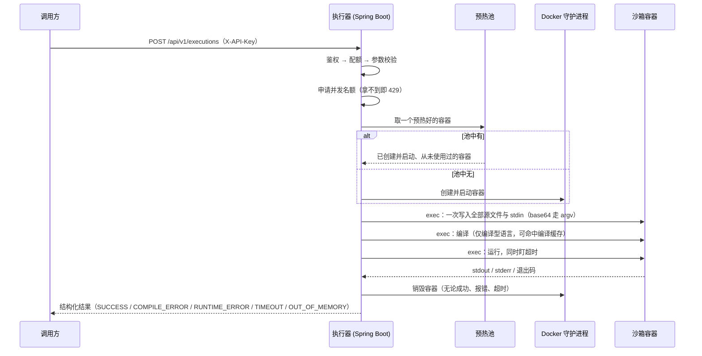

<h1 align="center">在线代码执行器</h1>

<p align="center">
  <b>简体中文</b> | <a href="./README_EN.md">English</a>
  <br><br>
  <a href="LICENSE"></a>
</p>

在线代码执行器：Spring Boot + Docker 的多语言代码沙箱。一请求一容器、绝不复用，15 项加固默认开启（断网、只读根文件系统、非 root、能力全丢、pids/内存/CPU 限额）。

仓库里没有截图或 GIF，下面用真实的端到端测试输出代替。

```text
──────────────────────────────────────────────────────────────
  1. 功能 — 三种语言各跑一次
──────────────────────────────────────────────────────────────
  [PASS] Python 执行成功
         status=SUCCESS exitCode=0 duration=188ms
  [PASS] Java 编译+运行成功
         status=SUCCESS duration=289ms
  [PASS] JavaScript 执行成功
         status=SUCCESS duration=238ms
  [PASS] UTF-8 中文与 emoji 正确回传
         stdout=中文输出测试：你好，世界 👋

──────────────────────────────────────────────────────────────
  3. 安全回归
──────────────────────────────────────────────────────────────
  [PASS] 断网：容器内连不上外网
         stdout=NETWORK_BLOCKED:OSError
  [PASS] 只读根文件系统：写不了 /etc
         stdout=ROOTFS_READONLY:OSError
  [PASS] 非 root 运行：uid 不是 0
         stdout=UID=10001
  [PASS] 进程数限制：挡住了 fork
         stdout=FORK_BLOCKED_AT=22 [Errno 11] Resource temporarily unavailable
  [PASS] 特权已丢弃：mount 不成功
         stdout=MOUNT_DENIED

  通过 53 / 53
```

> 以上是 `scripts/e2e-test.ps1` 的真实输出片段，不是示意。

## 目录

- [为什么做这个项目](#为什么做这个项目)
- [快速开始](#快速开始)
- [用法](#用法)
- [配置](#配置)
- [项目结构](#项目结构)
- [开发](#开发)
- [常见问题](#常见问题)
- [已知限制](#已知限制)
- [如何贡献](#如何贡献)
- [许可证](#许可证)

## 为什么做这个项目

跟着教程《在线代码执行器实现教程》学，但不想停在"能跑就行"。教程的实现里有几处安全上的将就——例如用 `docker cp` 把源码写进容器。那个做法在只读根文件系统下会直接失败（错误是 `container rootfs is marked read-only`），因为 `docker cp` 走的是守护进程侧的 rootfs 视图，看不到 tmpfs。本项目把它做成安全上站得住的版本。

目标读者：想学 Docker 容器隔离的后端开发者；需要给判题系统做沙箱、但不想直接上完整判题平台的团队。

与 [Judge0](https://github.com/judge0/judge0) 的区别：Judge0 是完整的判题平台（数据库、队列、多语言包、Web 界面），上手重。本项目只做"沙箱这一层"的最小实现，把 15 项加固、每项的取舍理由、以及实测数据都摊开写清楚，可以当参考实现读。

### 执行流程



## 快速开始

前置要求：

| 依赖 | 版本要求 | 说明 |
|---|---|---|
| JDK | **17** | 本项目按 17 编译，用 11 会报 `class file version 61.0` |
| Maven | 3.9+ | 或使用 IDE 内置的 |
| Docker Engine | **20.10+** | 需要 `--pids-limit`、`--memory-swap`、tmpfs 支持；Windows 上用 Docker Desktop（WSL2 后端） |

```sh
git clone https://github.com/ChenChen913/code-executor.git
cd code-executor

# 1. 构建沙箱镜像。首次约 2 分钟。
docker build --target runner-squashed -t code-executor-runner-min:1 .

# 2. 启动执行器。脚本会探测 JDK 17、检查 Docker、缺镜像则自动构建、生成 API Key。
powershell -ExecutionPolicy Bypass -File scripts/start.ps1
```

脚本最后会打印生成的 API Key。看到 `Started CodeExecutorApplication` 即启动完成。

验证：

```sh
curl -s http://localhost:8080/actuator/health
# {"status":"UP"}
```

`/actuator/health` 是唯一免鉴权的端点，可直接接进 Kubernetes 或监控系统。

Linux / macOS 上没有 PowerShell 时，手动启动等价于：

```sh
JAVA_HOME=/path/to/jdk17 \
EXECUTOR_AUTH_KEYS_0_NAME=local \
EXECUTOR_AUTH_KEYS_0_VALUE=local-key-0123456789abcdef \
mvn spring-boot:run
```

## 用法

提交一段 Java 代码，拿到结构化结果：

```sh
curl -s -X POST http://localhost:8080/api/v1/executions \
  -H 'Content-Type: application/json' \
  -H 'X-API-Key: <你的 key>' \
  -d '{
        "language": "java",
        "code": "public class Main { public static void main(String[] a){ System.out.println(\"hi\"); } }"
      }'
```

```json
{
  "jobId": "…",
  "language": "java",
  "status": "SUCCESS",
  "success": true,
  "exitCode": 0,
  "stdout": "hi\n",
  "stderr": "",
  "compileOutput": "",
  "truncated": false,
  "timedOut": false,
  "durationMs": 289,
  "compileCached": false
}
```

多文件与标准输入：

```sh
curl -s -X POST http://localhost:8080/api/v1/executions \
  -H 'Content-Type: application/json' -H 'X-API-Key: <你的 key>' \
  -d '{
        "language": "python",
        "code": "import helper\nprint(helper.add(*map(int, input().split())))",
        "files": { "helper.py": "def add(a, b):\n    return a + b\n" },
        "stdin": "3 4\n"
      }'
```

异步提交，长任务不占连接：

```sh
# 提交，立刻拿到 taskId
curl -s -X POST http://localhost:8080/api/v1/tasks \
  -H 'Content-Type: application/json' -H 'X-API-Key: <你的 key>' \
  -d '{"language":"java","code":"…"}'
# {"taskId":"…","language":"java","status":"PENDING"}

# 轮询
curl -s http://localhost:8080/api/v1/tasks/<taskId> -H 'X-API-Key: <你的 key>'
```

任务状态（`PENDING` / `RUNNING` / `COMPLETED` / `FAILED` / `CANCELLED`）与代码执行状态（`SUCCESS` / `COMPILE_ERROR` / …）是两层：前者说明"任务处理完了没有"，后者说明"代码跑得怎么样"。

完整接口说明见 [docs/03-接口文档.md](docs/03-接口文档.md)，安全设计见 [docs/04-安全设计.md](docs/04-安全设计.md)。

## 配置

配置来自 `src/main/resources/application.yml`。环境变量形式是 Spring Boot 的松散绑定。

<details>
<summary>完整配置项（点击展开）</summary>

| 配置键 | 环境变量 | 默认值 | 说明 |
|---|---|---|---|
| `executor.image` | `EXECUTOR_IMAGE` | `code-executor-runner:1` | 沙箱镜像名 |
| `executor.auth.enabled` | `EXECUTOR_AUTH_ENABLED` | `true` | 关掉会丢弃全部鉴权，仅限本机调试 |
| `executor.auth.keys[n].name` | `EXECUTOR_AUTH_KEYS_0_NAME` | 无 | 调用方标识，用于日志与配额 |
| `executor.auth.keys[n].value` | `EXECUTOR_AUTH_KEYS_0_VALUE` | 无 | 密钥，**少于 16 字符拒绝启动** |
| `executor.auth.keys[n].requests-per-minute` | `EXECUTOR_AUTH_KEYS_0_REQUESTS_PER_MINUTE` | `0`（用全局默认） | 单 key 覆盖；`-1` 不限 |
| `executor.dry-run` | `EXECUTOR_DRYRUN` | `false` | 演练模式，不需要 Docker 即可跑通全流程 |
| `executor.max-concurrent-executions` | `EXECUTOR_MAX_CONCURRENT_EXECUTIONS` | `4` | 全局并发上限，超出立即 429 |
| `executor.max-code-bytes` | `EXECUTOR_MAX_CODE_BYTES` | `65536` | 单次代码体积上限 |
| `executor.max-files` | `EXECUTOR_MAX_FILES` | `16` | 附加文件数量上限 |
| `executor.max-output-bytes` | `EXECUTOR_MAX_OUTPUT_BYTES` | `65536` | stdout / stderr 各自的上限，超出截断并置 `truncated` |
| `executor.workspace-size-mb` | `EXECUTOR_WORKSPACE_SIZE_MB` | `64` | `/workspace` 这个 tmpfs 的大小 |
| `executor.pool.enabled` | `EXECUTOR_POOL_ENABLED` | `true` | 容器预热池 |
| `executor.pool.warm-per-language` | `EXECUTOR_POOL_WARM_PER_LANGUAGE` | `1` | 每种语言预热几个 |
| `executor.async.enabled` | `EXECUTOR_ASYNC_ENABLED` | `true` | 关掉后 `/api/v1/tasks` 返回 404 |
| `executor.async.worker-threads` | `EXECUTOR_ASYNC_WORKER_THREADS` | `4` | 不应小于 `max-concurrent-executions` |
| `executor.compile-cache.enabled` | `EXECUTOR_COMPILE_CACHE_ENABLED` | `true` | 编译产物缓存 |
| `executor.quota.default-requests-per-minute` | `EXECUTOR_QUOTA_DEFAULT_REQUESTS_PER_MINUTE` | `60` | 每个调用方每分钟的执行次数上限 |
| `executor.quota.default-daily-quota` | `EXECUTOR_QUOTA_DEFAULT_DAILY_QUOTA` | `5000` | 每个调用方每天的执行次数上限 |
| `executor.seccomp-profile` | `EXECUTOR_SECCOMP_PROFILE` | 空 | 自定义 seccomp profile 的路径，见下 |
| `server.port` | `SERVER_PORT` | `8080` | 监听端口 |

</details>

> `EXECUTOR_AUTH_KEYS_0_NAME`、`EXECUTOR_AUTH_KEYS_0_VALUE`、`EXECUTOR_IMAGE` 三个变量形式经过实测；其余为 Spring Boot 松散绑定的对应形式。

### seccomp profile

`docker/seccomp-profile.json` 在 Docker 默认 profile 之上，额外拒绝 `ptrace`、`bpf`、`mount`、`kexec_load`、内核 keyring、`userfaultfd` 等沙箱里用不到的系统调用。

```sh
# Linux 上：把文件放到守护进程能读到的地方，再指向它
sudo cp docker/seccomp-profile.json /etc/code-executor/seccomp-profile.json
# 启动时加：--executor.seccomp-profile=/etc/code-executor/seccomp-profile.json
```

> ⚠️ 这个路径是 **Docker 守护进程所在机器**上的路径，不是执行器进程看到的路径。Docker Desktop for Windows 的守护进程跑在 WSL 虚拟机里，读不到 Windows 侧的文件，因此该配置在 Windows 上无法生效。实际拦截效果需要在 Linux 上验证。

## 项目结构

```
code-executor/
├── Dockerfile                    4 层：runner-base → polyglot → minimal → squashed（推荐）
├── docker/seccomp-profile.json   自定义 seccomp 策略
├── pom.xml                       Spring Boot 3.5.16 / Java 17
├── scripts/
│   ├── start.ps1                 一键启动（探测 JDK、检查 Docker、构建镜像、生成 key）
│   ├── e2e-test.ps1              53 项真实容器端到端断言
│   ├── benchmark.ps1             延迟分布测量
│   ├── demo.ps1                  演示脚本
│   └── watch-container.ps1       实时观察容器生命周期
├── docs/                         设计、部署、接口、安全、测试报告、进度交接
└── src/main/java/com/chenchen/codeexecutor/
    ├── core/                     沙箱核心
    │   ├── SandboxPolicy.java        全部 15 项加固参数的唯一出处
    │   ├── ContainerFactory.java     创建/销毁容器的唯一入口
    │   ├── ContainerPool.java        预热池（预热但不复用）
    │   ├── DockerCodeRunner.java     一次执行的完整流程
    │   ├── CompileCache.java         编译产物缓存
    │   └── ContainerReaper.java      孤儿容器回收与对账
    ├── security/                 API Key 鉴权与按调用方配额
    ├── language/                 语言配方（超时/内存/pids/命令）
    ├── model/                    请求、响应、状态枚举
    └── web/                      HTTP 接口与统一错误处理
```

改动前建议先读 [docs/06-进度与交接.md](docs/06-进度与交接.md) 末尾的「关键设计决定」，那里写了四处刻意为之的取舍（为什么容器绝不复用、为什么不做 webhook 等）。

## 开发

```sh
mvn -B test                                          # 115 个单元/集成测试，不需要 Docker
mvn -B clean package                                 # 打包
powershell -File scripts/e2e-test.ps1 -ApiKey <key>  # 53 项真实容器断言，需要 Docker
powershell -File scripts/benchmark.ps1 -ApiKey <key> # 测量执行延迟分布
```

改代码前建议知道两件事：

1. **单元测试过了不代表真容器能跑。** 这个项目里若干问题只有真实容器测试才暴露。例如回收器误杀正在执行的容器时，表现为"死循环程序跑 2 秒就异常退出，单独测又正常"。改完请两套都跑。
2. **`scripts/` 下的 `.ps1` 必须存为「UTF-8 带 BOM」。** PowerShell 5.1 会按 ANSI 读取 `.ps1`，中文注释会导致解析失败，报错信息是 `意外的标记 "[PASS]"` 这类内容。

## 常见问题

**Q：`mvn` 报 `class file version 61.0`？**
A：`JAVA_HOME` 指向了 JDK 11。本项目需要 JDK 17：`set JAVA_HOME=D:\java\jdk17`（Windows）或 `export JAVA_HOME=/path/to/jdk17`。

**Q：启动时报镜像找不到？**
A：先构建镜像 `docker build --target runner-squashed -t code-executor-runner-min:1 .`，再用 `--executor.image=code-executor-runner-min:1` 启动。

**Q：一直返回 `503`，提示连不上 Docker 守护进程？**
A：Docker 没启动，或 `executor.docker.host` 配错了。执行器把"环境没准备好"（503）和"执行器自己出错"（500）分开，看到 503 就先查 Docker。

**Q：`docker build` 卡在拉取基础镜像？**
A：国内直连 Docker Hub 常常不通。给 Docker Desktop 配镜像加速（例如 `docker.m.daocloud.io`）。`FROM scratch` 那层不需要拉取。

**Q：返回 `429`？**
A：两种可能。并发名额满了（同步接口不排队，直接快速失败），或触发了调用方配额。响应体的 `message` 会写明是哪一种。

**Q：轮询任务返回 `404`？**
A：任务结果有 TTL（默认 600 秒），过期即清理。另外任务状态存在内存里，重启执行器会清空。

**Q：为什么 Python 用 `-E -s` 而不是 `-I`？**
A：`-I` 隐含 `-P`，会把脚本所在目录从 `sys.path` 里去掉，导致 `import helper` 这类同目录导入失败。`-E -s` 只隔离环境变量和用户 site-packages，保留脚本目录。

## 已知限制

完整清单见 [docs/06-进度与交接.md](docs/06-进度与交接.md)。以下是影响使用的部分：

- **只支持三种语言**：Java、Python 3、JavaScript（Node）。加语言需要改 `src/main/resources/languages.yml` 与运行镜像。
- **无持久化**。执行结果、异步任务、编译缓存、调用方配额全部存在进程内存里：重启即清空，且**无法多节点部署**。
- **异步任务不能取消正在执行的任务**。`DELETE` 只对排队中的任务有效，执行中的返回 `409`。杀容器是另一套机制。
- **没有 webhook 回调**。执行器跑在内网且持有 `docker.sock`，让它主动 POST 到调用方指定的 URL 是现成的 SSRF 通道。异步结果只能轮询。
- **seccomp 自定义 profile 在 Windows + Docker Desktop 上无法生效**（守护进程跑在 WSL 里，读不到 Windows 侧的文件）。实际拦截效果需要在 Linux 上验证。
- **gVisor / Kata Containers 未实现**。开发机是 Windows + Docker Desktop，装不了 `runsc`。当前隔离强度 = namespace + cgroup + capability + seccomp + 只读根文件系统，**共享宿主机内核**。
- **单节点**。横向扩展需要先把任务状态、编译缓存、配额外置到 Redis。
- **预热池在高并发下的表现未验证**。端到端测试是顺序执行的。
- **最小化镜像只是减小可读面**。`--readonly` 挡不住读，镜像里有什么用户就能看到什么。`runner-squashed` 把镜像从 653MB 降到 484MB、容器内文件从 2837 个降到 2540 个，但这不等于安全隔离。

## 如何贡献

欢迎提 Issue 和 PR：[Issues](https://github.com/ChenChen913/code-executor/issues)。

提交信息用约定式提交（Conventional Commits）：`type(scope): 摘要`，摘要用中文祈使句、结尾不加句号。类型用 `feat` / `fix` / `docs` / `refactor` / `perf` / `test` / `build` / `ci` / `chore`。

改动的验证要求：`mvn -B test` 与 `scripts/e2e-test.ps1` 两套都要过。新增的安全相关行为，请在 `scripts/e2e-test.ps1` 里加一条断言。

## 许可证

[MIT](LICENSE)
