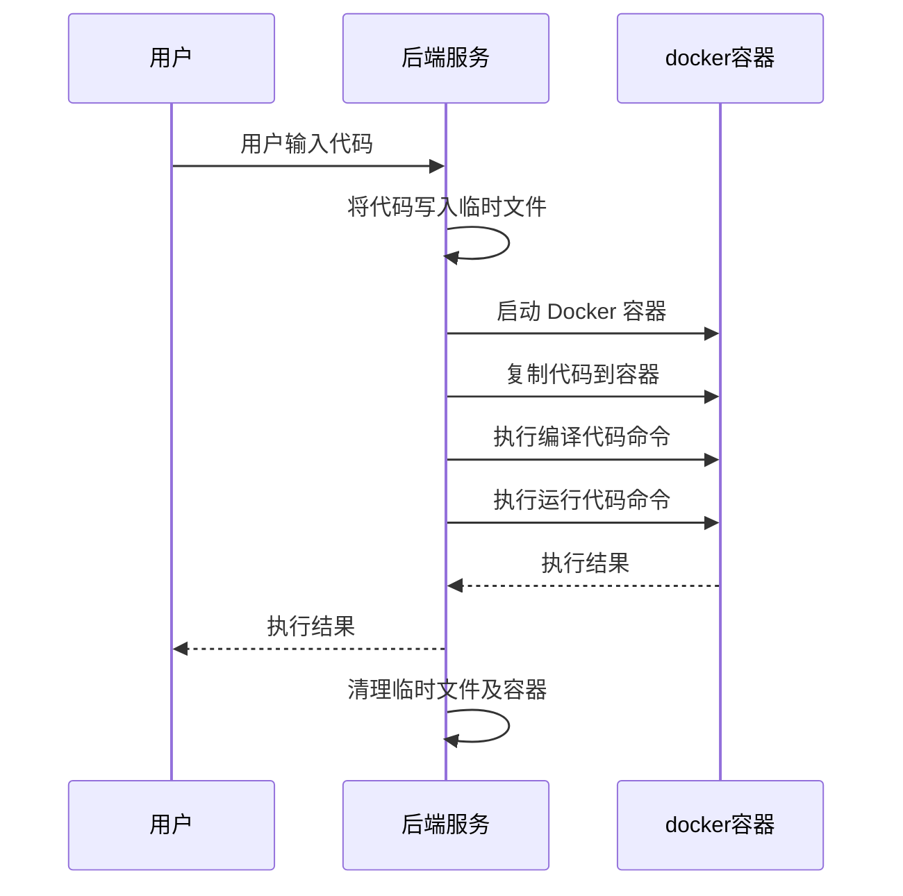
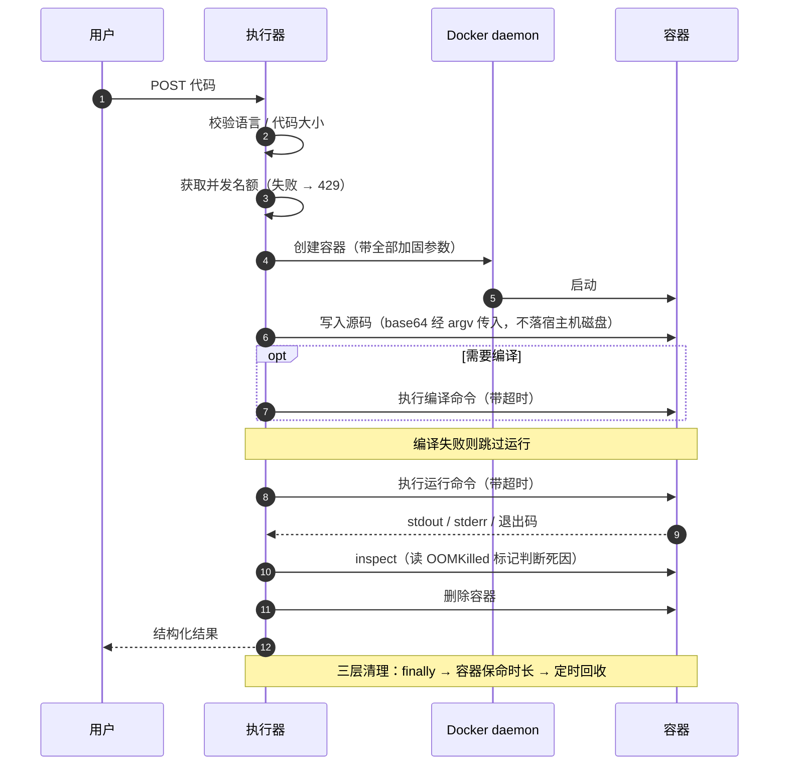

# 在线代码执行器实现教程（1 - 需求分析和设计）· 精修版

> **原文**：程序员cq ｜ 2024-07-09 17:39 ｜ 阅读 5.2k
>
> **本文来源**：`docs/images/tu01.png` ~ `tu08.png`（8 张文章截图）的完整转写
>
> **配套代码**：本仓库（[code-executor](https://github.com/ChenChen913/code-executor)）就是按本文的设计落地的实现

---

## 这份文档是什么

它有三层内容，混在一起但用标记区分：

| 标记 | 含义 |
|---|---|
| 📖 **原文** | 文章截图里的原始内容，**逐字保留**，包括不严谨的地方 |
| 🔧 **精修** | 对原文里不成熟、有漏洞或落不了地的设计给出的改进方案 + 理由 |
| 📐 **技术背景** | 支撑这些设计决策的底层机制。不熟悉容器的话建议先读第 0 章 |

**为什么保留原文？** 因为这份教程的价值在于它的思路演进：
先看竞品、再定选型、最后抽象设计，这条路径本身是对的。
改写成一份完美的设计文档，反而看不出"哪里容易踩坑"。

**精修部分主要改了四件事：**

1. **安全需求提了三条，核心设计里一条都没落实。** 照原文写，会做出一个"又一个菜鸟教程"——而原文自己刚批评过那一点。
2. **业务流程只有正常路径，没有失败路径。** 第 5、6 步一抛异常，容器就永久泄漏了。
3. **安全边界划错了。** 原文把"网络外传"归进"权限问题"，导致开发时容易只做权限控制、忘了断网。这两件事的防护机制完全不同。
4. **几个技术选择可以更稳**：大而全的镜像、宿主机临时文件、字符串拼命令、硬编码枚举。

---

# 第 0 章 · 技术背景：容器隔离靠什么

> 这一章写给"有后端基础但没系统用过 Docker"的读者。
> 不理解这些机制，后面每一条加固参数都只能死记硬背。

## 0.1 容器不是虚拟机

这一点必须先说清楚，因为它决定了整个安全模型的边界。

| | 虚拟机 | 容器 |
|---|---|---|
| 隔离层 | 硬件虚拟化（VT-x / AMD-V） | 宿主机的 **Linux 内核** |
| 内核 | 每个虚机一套独立内核 | **所有容器共享宿主内核** |
| 启动开销 | 秒级到十秒级 | 百毫秒级 |
| 隔离强度 | 高 | 低（内核漏洞 = 逃逸） |

**结论**：容器的隔离边界就是宿主机的内核。这意味着：

- 容器方案**不可能**防住内核 0day；这正是 gVisor、Kata Containers 存在的理由（第 9 章会讲）
- 但反过来说，只要内核没有漏洞，其他所有攻击面都是**可以通过配置关掉的**——
  这正是本项目 15 项加固要干的事

## 0.2 隔离由四个独立机制叠加而成

Docker 本身不实现隔离，它只是把内核提供的这几套机制拼装起来。
**理解它们各自管什么，是理解所有加固参数的前提。**

### （1）namespace —— 决定"看得见什么"

内核的隔离原语，把全局资源包装成每个进程私有的视图：

| namespace | 隔离对象 |
|---|---|
| `pid` | 进程号空间（容器内 PID 1 在宿主上并不是 1） |
| `net` | 网卡、路由表、iptables、端口空间 |
| `mnt` | 挂载点视图 ← **这一条和 0.4 节的 `docker cp` 坑直接相关** |
| `uts` | hostname / domainname |
| `ipc` | System V IPC、POSIX 消息队列 |
| `user` | uid/gid 映射（可把容器内 root 映射成宿主普通用户） |
| `cgroup` | cgroup 根目录视图 |

`--network none` 就是给容器一个空的 net namespace：只有 `lo`，没有外部接口，
路由表和 DNS 都失去意义。这是**在内核层面**断网，不是靠 iptables 规则拦——所以绕不过去。

### （2）cgroup —— 决定"能用多少"

控制组，对一组进程做资源计量与限额。加固参数与 controller 的对应关系：

| 参数 | 作用的 controller |
|---|---|
| `--memory` / `--memory-swap` | `memory` |
| `--cpus` / `--cpu-quota` | `cpu` |
| `--pids-limit` | `pids` |
| `--blkio-*` | `io` |

两个容易忽略的点：

- **`--pids-limit` 是挡 fork 炸弹的唯一手段。** fork 炸弹不耗内存（每个进程很小）、
  不超时（一直在正常 fork）、不越权（就是创建进程），但它能在数秒内耗尽宿主机的
  pid 表，让**整台机器**无法创建新进程。只有 `pids` controller 能拦。
- **`--memory-swap` 必须和 `--memory` 相等**才等于"禁用 swap"。如果只设 `--memory`，
  Docker 会默认给两倍 swap 额度，超限的页会被换出去，表现为**性能骤降而不是被杀**——
  这比直接 OOM 更难发现，也更难归因。

### （3）capability —— 把 root 特权拆开

传统 Unix 的权限模型是二元的：uid 0 什么都能干，非 0 什么都干不了。
Linux 从 2.2 起把 root 的特权拆成约 40 个独立的 capability 位，例如：

| capability | 能做什么 |
|---|---|
| `CAP_SYS_ADMIN` | 挂载、改 namespace、大量系统管理操作（最危险的一个） |
| `CAP_NET_ADMIN` | 配网卡、改路由、改 iptables |
| `CAP_SYS_PTRACE` | 调试 / 注入其他进程 |
| `CAP_DAC_OVERRIDE` | 绕过文件读写权限检查 |
| `CAP_SYS_MODULE` | 加载内核模块（等于完全控制内核） |

Docker 默认给容器保留约 14 个 capability。`--cap-drop ALL` 把它们全部丢弃，
之后即使进程是 uid 0，`mount()` 这类调用也会直接返回 `EPERM`。

**这也是"非 root 运行"和"丢 capability"要同时做的原因**：它们防的不是同一件事。
非 root 挡的是"利用 setuid 或文件权限配置错误提权"，
丢 capability 挡的是"进程本身直接调用特权系统调用"。

### （4）seccomp / LSM —— 最后一道过滤

- **seccomp**：按系统调用号过滤。Docker 默认加载一份 profile，拒绝一批高风险 syscall。
  这是"黑名单"模式，不是最小权限——本项目用的就是默认 profile，属于**已知的加固不足**
  （见第 10 章）。
- **LSM**（AppArmor / SELinux）：基于路径或安全标签的强制访问控制。
  本项目未启用自定义 LSM 策略，同样列入第 10 章。

## 0.3 镜像分层与可写层：`--read-only` 到底挡住了什么

这是最容易被误解的一条。

**镜像**是一组只读层的叠加（通常由 overlayfs 实现）。启动容器时，
Docker 在镜像之上再加一个**可写层**（overlayfs 的 upperdir），
容器内所有写操作都落在这一层——这就是写时复制（copy-up）：
修改一个文件时先把它从只读层复制到可写层，再修改。

`--read-only` 做的事情是：**把那个可写层也设为只读**。
之后容器里能写的地方只剩下**显式挂载**的 tmpfs 和 volume。

于是有两个必须清楚的结论：

### ✅ 它挡住了什么

写系统目录、改 `/etc`、装后门、写 crontab、往镜像里持久化任何东西。
用户代码想 `open("/etc/passwd", "w")` 会直接得到 `EROFS`。

### ❌ 它挡不住什么

**读。** 只读文件系统对读操作毫无影响。用户代码依然可以：

```python
open("/etc/passwd").read()          # 能读到
open("/proc/self/environ").read()   # 能读到环境变量
os.listdir("/usr/local")            # 能列出目录
```

这正是原文在菜鸟教程上实测到的现象——**它不是菜鸟教程的实现缺陷，
而是"只读根文件系统"这条措施本身的能力边界**。

所以"防读取"必须是**另一套机制**，共三条，缺一不可：

| 机制 | 作用 |
|---|---|
| `--network none` | 读到了也**传不出去**。这是性价比最高的一条 |
| 最小化镜像 | 缩小可读面：镜像里没有的东西，就读不到 |
| 非 root + 文件权限 | 挡住需要特权的读取（如 `/etc/shadow`） |

> **本项目当前的取舍**：做了第一条和第三条，**没有做"最小化镜像"**。
> 也就是说用户代码可以读到 Alpine 基础镜像里的 `/etc/passwd`。
> 断网让这件事的危害从"数据泄露"降级为"攻击者自己看到了"，
> 但这仍然是一个应当记录的**残余风险**（见第 10 章）。

## 0.4 `docker exec` 和 `docker cp` 是两条不同的路径

这个坑本项目实测踩到过，写在这里可以省掉后来者几个小时。

直觉上两者都是"操作容器内的文件系统"，但它们的执行位置不同：

| | 谁在执行 | 看到的是哪个文件系统视图 |
|---|---|---|
| `docker exec` | 在**容器的 mount namespace 里** fork 一个进程 | 容器进程看到的完整视图，**包含 tmpfs 与 volume 挂载** |
| `docker cp` | **Docker 守护进程**按容器 rootfs 路径直接写 | 守护进程侧的 rootfs（overlayfs），**看不到容器内的挂载点** |

后果：`docker cp` 往 `--read-only` 容器的 tmpfs 工作目录里复制文件，会被直接拒绝：

```
Status 400: {"message":"container rootfs is marked read-only"}
```

**工作目录明明是可写的**（在 `docker exec` 里写就没问题），但 `docker cp` 照样失败——
因为守护进程侧的 rootfs 是只读的，而它根本不知道 tmpfs 的存在。

这个差异直接影响第 6 章"怎么把源码送进容器"的方案选择。

## 0.5 术语速查

| 术语 | 说明 |
|---|---|
| **镜像** image | 只读文件系统层的集合，按 OCI Image Spec 组织，通常由 Dockerfile 构建产生 |
| **容器** container | 镜像 + 一个可写层 + 一组 namespace/cgroup 配置的运行时实例 |
| **可写层** | overlayfs 的 upperdir；`--read-only` 将其置为只读 |
| **tmpfs** | 基于内存的临时文件系统；挂载点位于容器 mount namespace 内，容器销毁即消失 |
| **namespace** | 内核隔离原语，决定"看得见什么" |
| **cgroup** | 内核资源控制原语，决定"能用多少" |
| **capability** | 把 root 特权拆成约 40 个独立位的机制 |
| **seccomp** | 按系统调用号过滤进程可发起的 syscall |
| **LSM** | Linux Security Module（AppArmor / SELinux），基于路径或标签的强制访问控制 |
| **overlayfs** | 联合文件系统，实现镜像分层与写时复制（copy-up） |
| **OCI** | Open Container Initiative，容器镜像与运行时的标准化组织 |
| **OOMKilled** | cgroup memory controller 触发的内核 OOM Killer 标记，用于区分"被杀"与"自行退出" |
| **孤儿容器** | 未经正常清理流程删除、仍占用资源的容器实例 |
| **SSRF** | Server-Side Request Forgery：诱导服务端发起攻击者指定的请求 |

---

# 第 1 章 · 需求背景

## 📖 原文

> 相信很多人都曾经遇到过这样的情况：在处理一些简单的代码时，我们希望立即获取这段代码的执行结果，
> 却又不想打开集成开发环境（IDE）来运行。甚至有时候我们没有安装某些编程语言的编译器，
> 还需要单独下载一个编译器，再执行代码。这无形中浪费了大量的时间。
> 因此，我们需要一款工具，能够在线执行我们常用的代码，轻松地运行各种常见的编程语言。
>
> 而我们这次要做的不仅是一个在线代码执行器，更要做一个 **starter**，
> 让其他服务可以很轻松的接入我们提供的在线代码执行器。

## 🔧 精修

这段需求背景写得很好，特别是最后一句——**"不仅是一个执行器，更要做一个 starter"**。

这句话是整个项目里最有价值的一句，因为它把评价标准从"能跑"抬到了另一个层次：

> 自己用的工具，跑通就行；
> 给别人接入的 starter，必须回答"**别人凭什么敢把用户代码交给它**"。

但原文后面并没有沿着这句话展开。一个可被他人接入的组件，至少还要回答：

| 问题 | 原文提到了吗 |
|---|---|
| 谁在调用我？怎么鉴权？ | ❌ |
| 每个调用方每天能用多少？ | ❌ |
| 我忙不过来的时候怎么办？ | ❌ |
| 出问题怎么定位？（哪次执行、什么语言、多久、为什么失败） | ❌ |
| 接口协议与错误语义是什么？ | 部分（只有"返回结果或错误信息"） |

这些不是"以后再补"的东西。**starter 的对外契约一旦有人接入，改起来就要通知所有调用方**，
所以它必须比功能更早定下来。精修版在第 7 章给出契约，在第 9 章把其余部分排进路线图。

---

# 第 2 章 · 需求分析

## 2.1 功能需求

### 📖 原文

> 根据上面的需求背景，我们可以抽出两个最核心的功能：
>
> 1. 支持大多数常用代码的运行能力。
> 2. 返回运行结果或者相关错误信息。
>
> 也就是说，我们的服务端需要提供一个大而全的环境可以对各种常用的编程语言都能进行编译运行并返回对应的运行结果。
>
> 至于要支持哪些语言，可以根据 TIOBE 排行榜来确定要支持的语言（官网：<https://www.tiobe.com/tiobe-index/>）：

因此原文这个在线代码执行器要支持这些语言：

- Python
- C
- C++
- Java
- JavaScript
- Go
- TypeScript

### 🔧 精修 1：语言清单按"调用方"裁剪，而不是按排行榜

TIOBE 回答的是"世界上哪些语言用得多"，这个项目要回答的是"**我的调用方需要跑哪些语言**"。
两者经常不一致。如果调用方是个 Python 教学平台，把 Go、Rust、TypeScript 都装进镜像，
纯粹是在给自己增加**攻击面**和**镜像体积**——而这两项都是第 4 章里要付代价的。

**建议的第一版清单：只做两门，刻意选在抽象的两端。**

| 语言 | 执行模型 | 为什么选它 |
|---|---|---|
| **Java** | 编译型，两阶段 | 有"先编译再运行"两个阶段，能验证流程抽象是否成立 |
| **Python** | 解释型，单阶段 | 没有编译阶段，能验证"编译命令可为空"这个设计是否成立 |

这两种都跑通，**抽象就是对的**——之后加任何语言都只是改配置。
反过来，一上来铺开 7 门语言，你会在调 Golang 的编译参数时，
还没意识到流程抽象本身是错的。

> 本仓库实际配置了 Java + Python + JavaScript 三种。
> JavaScript 属于白送（`node main.js`，与 Python 同构），
> 加它是为了验证"改配置就能加语言"，而不是为了凑数。

### 🔧 精修 2：TypeScript 不是"又一个 JavaScript"

原文把 TypeScript 与 JavaScript 并列。但两者的执行模型完全不同：

| | 执行方式 | 是否有编译阶段 |
|---|---|---|
| JavaScript | `node main.js` | 无 |
| TypeScript | 先 `tsc` 编译为 JS，或经 `tsx` / `ts-node` 运行时 | **有** |

两个实际后果：

1. **TypeScript 的编译超时必须单独放宽。** `tsc` 在冷启动、无增量缓存的情况下
   编译一个稍大的文件，数秒很正常；沿用 Python 的 5 秒运行超时会大量误杀。
2. **TypeScript 的错误天然分两段**：类型错误（编译期）与运行错误（运行期）。
   这正是第 5.4 节"编译错误与运行错误必须分离"的真实用例。
   如果两种错误混在同一个 `error` 字段里，TypeScript 用户几乎无法排错。

### 🔧 精修 3："大而全"要改成"够用就好"

> 原文："我们的服务端需要提供一个大而全的环境"

这个方向同时牺牲三样东西，且收益并不明确：

| 代价 | 机制 |
|---|---|
| **镜像体积** | 语言工具链叠加后轻松到数 GB；每次部署、扩容、新节点都要传输这些层 |
| **攻击面** | 镜像里每个工具都是潜在入口，且部分工具本身就是攻击工具：`curl` / `wget` 可外传数据，`gcc` 可编译任意二进制 |
| **冷启动** | 镜像层数越多，容器创建时的挂载与初始化越慢——而冷启动是本项目的主要性能瓶颈 |

替代方案是**分层 + 按需**，细节见第 4 章。

## 2.2 安全需求

### 📖 原文

> 首先我们要保证用户执行的代码不能占用过多内存，如果有人在代码里写了个死循环不断创建新的对象
> 大量占用我们服务器的内存资源，或者有人在代码里写了一个睡眠一万年的代码，并且发送了很多请求，
> 这些操作无疑都会大量占用我们服务器的线程资源和内存资源，使得其它正常的请求会出现各种延迟
> 和资源短缺的问题，甚至导致我们的服务器宕机。
>
> 其次就是权限问题，如果有人恶意执行了一些读取文件的命令，例如 `ls` 这类查看文件的命令，
> 然后获取到我们服务器的另外一些服务信息，甚至可能直接读取到我们项目数据库的密码，
> 这对我们的服务而言是灾难性的打击，如果攻击者又通过网络把我们服务器的一些文件上传到用户那里，
> 那我们的服务就等于完全暴露给攻击者了。
>
> 总结一下，我们可以把这些问题分为下面三点：
>
> 1. 内存限制
> 2. 时间限制
> 3. 权限限制

### 🔧 精修：把"三条限制"还原成一张威胁表

原文的结论是"三条限制"，但这是从**对策**角度归纳的，因此漏掉了两条。
更严谨的做法是从**威胁**角度建表——每条威胁独立列出，再对应到机制：

| 类别 | 具体手法 | 直接后果 | 对应机制 | 原文 |
|---|---|---|---|---|
| 资源耗尽 | 无限分配内存 | cgroup OOM；宿主机内存压力 | `--memory` + `--memory-swap` | ✅ |
| 资源耗尽 | 死循环 / 挖矿 | 抢占 CPU | `--cpus` | ➖ 并入"时间限制" |
| 资源耗尽 | fork 炸弹 | **耗尽宿主机 pid 表**，整机无法创建进程 | `--pids-limit` | ❌ |
| 资源耗尽 | 长任务 + 高并发 | 占满执行器的线程与连接 | 应用层超时 + **并发上限** | ➖ 只提了"时间限制" |
| 资源耗尽 | 无限写文件 | 写满宿主机磁盘 | tmpfs 容量上限 + 只读根文件系统 | ❌ |
| 资源耗尽 | 无限打印 | **打爆执行器 JVM 堆** | 输出截断 | ❌ |
| 信息泄露 | 读文件系统 | 读到配置、密钥 | 非 root + 最小化镜像（⚠️ 只读**挡不住读**） | ✅ |
| 信息泄露 | 网络外传 / SSRF | 内网探测、数据外泄 | `--network none` | ❌ **原文把它归进了"权限问题"** |
| 信息泄露 | 读容器元数据 | 泄露内网 DNS、拓扑信息 | `--dns 127.0.0.1` | ❌ |
| 提权 | 内核漏洞 | 容器逃逸 | 非 root + cap-drop + seccomp + 及时打补丁 | ✅ 部分 |
| 提权 | setuid / 配置错误 | 宿主机 root | `no-new-privileges` + **不挂载 docker.sock** | ❌ |
| 未授权访问 | 任何人调接口 | **等价于宿主机 root**（执行器持有 docker socket） | **API Key 鉴权，且默认开启** | ❌ 原文完全未提 |
| 滥用 | 代理 / 端口扫描 | 出口 IP 被拉黑，或被当作跳板 | `--network none` | ❌ |

### 精修要点一：网络限制必须独立成条

原文其实**已经描述了**这个威胁——"如果攻击者又通过网络把我们服务器的一些文件上传到用户那里"——
但把它归进了"权限问题"。这个归类错误有实际后果：

> 开发时会认为"做了权限控制就等于做了安全"，于是**忘了断网**。

而这两件事的机制完全不同、防护的东西也不重叠：

| | 权限限制 | 网络限制 |
|---|---|---|
| 机制 | 非 root + cap-drop + 只读根文件系统 | `--network none`（空 net namespace） |
| 挡住 | "能碰到什么" | "能送出去什么" |
| 代价 | 可能误伤正常功能（详见 5.5） | 几乎为零 |

**性价比最高的一条是断网。** 一行配置，就能把"数据泄露"降级为"攻击者自己看到了"。

### 精修要点二：输出限制防的是执行器自身

原文的三条限制，防的都是"用户代码伤害宿主机"。但有一类攻击防不住：
**用户代码伤害执行器进程本身**。

```python
while True:
    print("x" * 1000)
```

这段代码：不超内存（容器内存稳定）、不超时（一直在正常输出）、不越权（就是往 stdout 写）。
但它每秒产生数百 MB 输出，**这些输出会全部进入执行器的 JVM 堆**——
容器限制得再严也没用，被打爆的是执行器。

所以输出上限不是性能优化，是**必需的安全需求**，且必须作用在应用层——
容器层面的任何限制都拦不住它，因为从容器视角看，这个进程一切正常。

---

# 第 3 章 · 功能调研

## 3.1 市场上已有的网站

### 📖 原文

> **1、菜鸟教程**
>
> 类似于星球里的 oj 项目，用到容器相关的技术，保证进程的隔离，
> 但是**没做安全校验，实测可以写入文件、读取文件和执行命令**：

原文截图里的验证代码（Java）：

```java
import java.io.BufferedReader;
import java.io.IOException;
import java.io.InputStreamReader;
import java.nio.charset.StandardCharsets;
import java.nio.file.Files;
import java.nio.file.Path;
import java.nio.file.Paths;
import java.nio.file.StandardOpenOption;

public class Test {
    public static void main(String[] args) throws InterruptedException {
        //path path = Paths.get("test");
        byte[] bytes = "aaa".getBytes(StandardCharsets.UTF_8);
        try {
            Files.write(path, bytes, StandardOpenOption.CREATE, StandardOpenOption.WRITE);
            System.out.println(Files.readAllLines(path));
        } catch (IOException e) {
            System.out.println(e.getMessage());
            throw new RuntimeException(e);
        }*/
        try {
            // 关键：执行了 shell 命令
            Process process = Runtime.getRuntime().exec("ls -a /usr/local");

            BufferedReader reader = new BufferedReader(new InputStreamReader(p...
            // （截图在此截断）

            StringBuilder output = new StringBuilder();
            String line;
            while ((line = reader.readLine()) != null) {
                output.append(line).append("\n");
            }

            int exitCode = process.waitFor();

            if (exitCode == 0) {
                System.out.println(output);
```

**运行结果**：容器内 `/usr/local` 被完整列出，暴露出这个环境装了哪些工具链：

```
.               clojure-1.10.1   gcc-9.2.0     man            python-3.8.1   share
..              composer-2.8.9   ghc-8.8.1     mono-6.6.0.161 ruby-2.7.0     src
bash-5.0        dotnet-sdk       gnucobol-2.2  nasm-2.14.02   rust-1.40.0    swift-5.2.3
bin             elixir-1.9.4     go-1.13.5     node-12.14.0   sbcl-2.0.0
clojure         erlang-22.2      groovy-3.0.3  ocaml-4.09.0   sbin
                etc              include       octave-5.1.0   scala-2.13.2
                fbc-1.07.1       kotlin-1.3.70 openjdk-11.0.6
                gcc-7.4.0        lib           perl
                gcc-8.3.0        lua-5.3.5     php-7.4.1
                gcc              make          python-2.7.17
```

> 注：部分目录名因截图分辨率模糊，按可辨识内容整理。

原文继续验证：**菜鸟教程可以将原本的类名改为 Main**，
把 `Runtime.getRuntime().exec("ls -a /usr/local")` 换成 `"cat Main.java"` 后，
容器里的源码文件被完整打印了出来——**证明容器内文件可读**。

以及：**菜鸟教程的 JavaScript 只能嵌入在 HTML 中运行，且运行结果在浏览器的控制台中**，
服务端并没有真正的 JS 执行环境。

原文补充的菜鸟教程实现信息：

> 1）**开发环境**：所有的编译工具都配置在 `/usr/local` 中。
> 2）**运行方式**：运行脚本都写在一个名为 `run` 的可执行文件中，再利用程序执行该脚本。
> 3）**运行环境**：类似于 docker 的容器，每次请求都是创建新的容器。

> **2、glot**
>
> GitHub 地址：<https://github.com/glotcode/glot>
> 和菜鸟教程类似，但是不能将类名自动转换为 `Main`。

> **3、码曰**
>
> <https://www.dotcpp.com/run/>
> **有权限控制，不允许读写文件，超时控制，据推测使用的是 `JavaSecurityManager`。**

原文截图中码曰的报错：

```
Exception in thread "main" java.security.AccessControlException:
access denied ("java.io.FilePermission" "/usr/local" "execute")
```

## 3.2 开源项目

### 📖 原文

> **1）RemoteCodeCompiler**
> 117 star，最近一次更新是 7 月前。
> <https://github.com/zakariamaaraki/RemoteCodeCompiler>
>
> 支持语言：Java、Kotlin、Scala、C、C++、C#、Golang、Python、Ruby、Rust、Haskell
>
> 基础原理：创建出不同编程语言的镜像，再通过前端传入的编程语言创建容器，
> 在创建出的容器中运行代码获取返回结果。
> 操作 docker：直接使用命令行执行 docker 操作。

> **2）jitcompiler**
> 58 star，最近一次更新在去年。
> <https://github.com/rajkumardusad/jitcompiler>
> 实现了 40+ 种语言。
> 创建了一个多种语言的镜像，随后根据镜像启动一个容器，在该容器中运行服务从而执行各类代码。

> **3）GitHub - bhargavgolla/Online-Compiler**
> 100 star，最近一次更新 7 年前，php。❌

## 3.3 调研总结

### 📖 原文

> 当前市场上已有在线代码执行器，大多都是使用容器与宿主机隔离，避免对宿主机造成不良影响，
> **且使用容器执行代码时，不对应用的执行权限做处理，仅仅是对内存或者运行时间做了限制。**

### 🔧 精修：调研的三处缺口，以及这个结论该怎么读

#### 缺口一：漏了这个领域事实上的标准实现 Judge0

<https://github.com/judge0/judge0> 是在线判题 / 代码执行方向被大量教学平台采用的实现。
不研究它，等于做竞品分析时跳过了市场占有率第一的方案。它值得单独看三点：

- 多语言镜像的组织方式（每语言独立，还是共享基础层）
- 接口语义（同步 / 异步 / 批量）以及它如何表达"编译失败"与"运行失败"
- **编译结果缓存**——这是它吞吐量高的主要原因之一，值得单独研究

#### 缺口二：调研维度里少了"资源清理"

原文对每个项目的调研集中在"支持哪些语言""怎么隔离"，
但没有一家记录了"容器什么时候删、删失败怎么办"。

而这一列恰恰是**这类服务最容易在生产上出事的地方**：
一次异常的 `kill -9` 就能在宿主机上留下几十个各占 128MB 的容器，
一晚上把内存吃光。这类故障不会立刻报警，只会表现为"服务越来越慢，最后 OOM"。

#### 缺口三：只调研了"用容器隔离"，没调研"比容器更强的隔离"

原文结论是"大家都用容器隔离，且都不做权限控制"。但值得知道行业前沿在哪：

| 方案 | 隔离层 | 代价 |
|---|---|---|
| 普通容器 | 共享宿主内核 + namespace/cgroup | 内核漏洞即可逃逸 |
| **gVisor** | 用户态内核，拦截并重新实现系统调用 | 系统调用开销增加，兼容性偶有问题 |
| **Kata Containers** | 轻量虚拟机，每个 Pod 独立内核 | 启动更慢，内存开销更高 |
| **独立物理机** | 物理隔离 | 成本最高，隔离最强 |

对 v1 来说容器足够，**但要在文档里明确写下"我们知道容器不是最强隔离"**，
并把它排进路线图——这就是"知道自己方案的边界在哪"。

#### 关于原文结论的正确读法

> "大多都是使用容器与宿主机隔离……**不对应用的执行权限做处理，仅仅是对内存或者运行时间做了限制**"

这是整份调研里信息量最大的一句，但原文只把它当成现状描述就过去了。它同时说明两件事：

**第一，这是被普遍忽略的一点——所以它是差异化点。**
如果所有竞品都不做权限控制，那你做了，就有了别人没有的能力。
原文把"别人都不做"当成了常态，而不是机会。

**第二，这是大家都踩过的坑——所以它比看起来难。**
为什么大家都不做？通常不是没想到，而是：

- **权限控制和"能用"是冲突的。** 很多语言的正常使用（写临时文件、装依赖、开子进程）
  都依赖写权限。一刀切禁掉后，用户会立刻反馈"我的代码跑不了"。
- **权限控制的报错很难懂。** 码曰那个 `AccessControlException` 就是典型：
  用户看到的是 `access denied ("java.io.FilePermission" ...)`，完全不知道该怎么办。

这才是第 5.5 节必须写成"每一项限制开在哪、为什么、会不会误伤"，而不是一句
"要限制权限"的原因。

---

# 第 4 章 · 技术选型

## 📖 原文

> - SpringBoot
> - docker 容器隔离运行代码
> - docker-java 调用本地 docker 的功能
>
> 我们可以构建一个尽量大而全的镜像，可以包含大部分编程语言，
> 让我们尽量用一个镜像执行所有类型的编程语言获得执行结果。

## 🔧 精修：镜像策略的三方权衡

前三条选型（SpringBoot / Docker / docker-java）是同类项目的标准组合，没有问题。
**唯一需要重做的是最后一句："一个尽量大而全的镜像"。**

调研里其实已经出现了两种相反的方案，原文没有把它们摆在一起比较：

| 方案 | 代表 | 优点 | 代价 |
|---|---|---|---|
| **单一大镜像** | 原文选型、jitcompiler | 简单；一次拉取；加语言只改配置 | 体积数 GB；攻击面 = 所有工具链的并集；冷启动慢 |
| **每语言一个镜像** | RemoteCodeCompiler | 体积小；攻击面按需；启动快 | 镜像数量多，需要管理版本矩阵 |
| **一镜像 + 常驻服务** | jitcompiler | 启动最快（服务常驻） | ⚠️ 常驻服务本身成为新的攻击面，且服务进程可被攻击 |

### 建议：不是二选一，而是分层

真正的问题不是"一个镜像还是多个"，而是"**镜像里的东西能否按需组合**"。
OCI 镜像的分层机制天生就是干这个的——未被引用的层不会进入最终镜像：

```
┌─────────────────────────────────────────┐
│ 语言层：python3 + nodejs                 │  ← 不需要的语言，这一层不存在
├─────────────────────────────────────────┤
│ 语言层：openjdk-17                       │
├─────────────────────────────────────────┤
│ 基础层：alpine + 非 root 用户 + 通用加固  │  ← 所有镜像共享
└─────────────────────────────────────────┘
```

收益：

- **只需 JVM 的部署**：`docker build --target runner-base`，镜像里连 Python 都没有，
  对应的攻击面直接消失
- **需要全量**：默认目标即全量，与原文目标一致
- **加一门语言**：加一个 stage，前面的层全部命中构建缓存

本仓库的 [Dockerfile](../Dockerfile) 就是按这个思路写的，两个构建目标：

```bash
docker build --target runner-base     -t code-executor-runner-jvm:1 .   # 只有 JVM
docker build --target runner-polyglot -t code-executor-runner:1    .    # 全量（默认）
```

---

# 第 5 章 · 核心设计

## 5.1 语言抽象：3 个字段不够，要 7 个

### 📖 原文

> 在设计之前，我们可以考虑一下，不同语言的执行都有哪些不同，也就是我们要把什么抽象出来？
>
> **1）编译的命令**
> 不同编程语言不同，且有的编程语言并不用执行编译。
>
> **2）运行的命令**
> 某些语言是可以直接以可执行文件执行，例如 c/cpp、go；
> 有些语言不能以可执行文件执行，例如 Java。
>
> **3）内容和文件名的关联**
> 例如 Java 的类名要和文件名一致。
>
> 考虑到这三点，那么其实我们要抽象出来的就是以下三点：
>
> - 编译命令（不用编译的语言可以设置为空）
> - 运行命令
> - 保存的文件名（目的是为了兼容不同语言的代码文件）
>
> 因此我们可以设计一个**枚举**，在枚举中编写不同语言的语言类型、保存的文件名，以及编译和运行的命令。

### 🔧 精修：抽象方向正确，字段缺了四个

"编译命令 / 运行命令 / 文件名"是**最小可用抽象**，思路是对的。
但把它放进业务流程走一遍就会发现撑不住：

| 字段 | 原文 | 为什么必需 |
|---|---|---|
| 编译命令 | ✅ | |
| 运行命令 | ✅ | |
| 保存的文件名 | ✅ | |
| **编译超时** | ❌ | C++ 编译与 Python 执行**不在一个量级**。用统一超时，要么误杀 C++，要么让 Python 能跑 30 秒 |
| **运行超时** | ❌ | 同上，且与编译超时应当是两个独立的值 |
| **内存上限** | ❌ | 安全需求第 1 条就是内存限制，但核心设计里没有它的位置——**这是"需求与设计脱节"的具体表现** |
| **进程数上限** | ❌ | 防 fork 炸弹。该攻击不占内存、不超时、不越权，只有 pids 限制能挡（见 0.2 节） |

补齐后的配置结构（本仓库 `languages.yml` 的实际字段）：

```yaml
java:
  display-name: Java 17          # 展示名
  enabled: true                  # 可开关（灰度用）
  source-file-name: Main.java    # 容器内文件名
  compile-command: [ javac, ... ]# 编译命令（空数组 = 不需要编译）
  run-command: [ java, ... ]     # 运行命令
  compile-timeout-ms: 20000      # ← 新增
  run-timeout-ms: 8000           # ← 新增
  memory-mb: 256                 # ← 新增
  pids-limit: 64                 # ← 新增
```

## 5.2 从"枚举"到"配置文件"

### 📖 原文

> 因此我们可以设计一个**枚举**，在枚举中编写不同语言的语言类型、保存的文件名，以及编译和运行的命令。

### 🔧 精修：枚举的问题不是"不好"，是"改不动"

在第一版用枚举完全可以，甚至更好——类型安全、IDE 可跳转、写错编译不过。
问题出在"加一门语言"这个动作的**成本**上：

| | 枚举 | 外部配置（YAML） |
|---|---|---|
| 加一门语言 | 改代码 → 编译 → 打包 → 重启 → 发版 | 改配置 → 重启 |
| 谁来改 | 必须是开发者 | 运维也能改 |
| 灰度 | 难（要发版） | 容易（先 `enabled: false`，验证完再打开） |
| 多环境差异 | 难 | 天然支持 |
| **写错时何时发现** | **编译期** ✅ | 启动期 ⚠️ |

**关键取舍**：换成配置后丢掉了"编译期发现写错"这个优势，所以**必须把它补回来**——
启动时全量校验，配错就启动失败。本仓库的做法（`LanguageRegistry` 构造函数）：

```java
if (spec.getSourceFileName() == null || spec.getSourceFileName().isBlank()) {
    throw new IllegalStateException(where + " 缺少 source-file-name");
}
// 关键的安全校验：文件名要拼进容器内的路径，绝不能带目录分隔符或 ..
if (fileName.contains("/") || fileName.contains("\\") || fileName.contains("..")
        || fileName.startsWith(".")) {
    throw new IllegalStateException(where + " 的 source-file-name 必须是不含路径的纯文件名");
}
```

> **宁可服务起不来（日志里写得清清楚楚），也不要等用户提交代码了才发现编译命令是空的。**

## 5.3 命令执行：为什么参数必须是数组

### 🔧 精修（原文未涉及，但这是最容易埋雷的一处）

原文截图里的验证代码是这么写的：

```java
Process process = Runtime.getRuntime().exec("ls -a /usr/local");
```

这行代码有两个问题，第二个是安全问题：

**问题一：按空白切分。** Java 的 `Runtime.exec(String)` 用 `StringTokenizer` 按空白切分字符串。
路径含空格时（`/opt/my tools/`）会被切成两个参数，行为与预期不符。

**问题二：参数可控时构成命令注入。**

```java
exec("javac " + fileName);
// fileName = "Main.java; rm -rf /" 会怎样？
```

**正确做法：一律用数组。**

```java
exec(new String[]{"javac", "-encoding", "UTF-8", "-d", ".", fileName});
```

从系统调用层面看这个差别：

| | 字符串形式 | 数组形式 |
|---|---|---|
| 调用链 | `exec(String)` → 内部分词 → `execve` | 直接 `execve` |
| 分词 | 有，按空白 | **无** |
| 元字符（`;` `&&` `$()` 反引号） | 由 shell 解释 | **退化为普通字符** |

要点是：**只有经过 shell 才会发生"解析"，只有解析才谈得上注入。**
数组形式下参数直接交给 `execve`，中间没有 shell。

这条规则在**两层都适用**：

| ❌ 不要 | ✅ 要 |
|---|---|
| `docker exec c sh -c "javac Main.java"` | `docker exec c javac Main.java` |
| `new String[]{"sh", "-c", "javac " + file}` | `new String[]{"javac", file}` |

本仓库的落实（`DockerCodeRunner.execPhase`）：

```java
docker.execCreateCmd(containerId)
        .withCmd(command.toArray(new String[0]))   // ← 数组，不是拼好的字符串
        .withAttachStdout(true)
        ...
```

## 5.4 结果模型：状态机，而不是布尔值

### 📖 原文

> 2. 返回运行结果或者相关错误信息。

### 🔧 精修：用户需要知道的不是"失败了"，而是"怎么失败的"

"运行结果或错误信息"落到实现上，通常会变成这样：

```java
return new Result(exitCode == 0, output);   // 常见的偷懒写法
```

问题在于用户拿到 `success = false` 后不知道要改什么。**不同失败原因的修法完全不同**：

| 状态 | 用户该做什么 | 该看哪个字段 |
|---|---|---|
| `COMPILE_ERROR` | 改语法 / 类型 | `compileOutput` |
| `RUNTIME_ERROR` | 改逻辑 / 看异常栈 | `stderr` |
| `TIMEOUT` | 查死循环，或申请更大配额 | `message` |
| `OUT_OF_MEMORY` | 查数据量，或申请更大配额 | `message` |
| `DRY_RUN` | 本次未真正执行 | `stdout`（内含渲染好的命令） |

所以结果模型应当是一个**带状态的结果**：

```java
public record ExecutionResponse(
        String jobId,            // 本次执行 id，排查问题时用它定位容器
        String language,
        ExecutionStatus status,  // ← 状态机
        boolean success,
        Integer exitCode,
        String stdout,           // 运行阶段输出
        String stderr,
        String compileOutput,    // 编译阶段输出（独立一份）
        boolean truncated,       // 输出是否被截断
        boolean timedOut,
        long durationMs,
        String message) { }
```

两个容易被忽略的字段：

- **`compileOutput` 必须与 `stdout`/`stderr` 分离。** 混在一起时，
  用户面对一坨编译错误加运行输出，无法分辨哪一句是自己程序的输出。
- **`truncated` 必须显式返回。** 输出被截断而用户不知道，他会以为自己程序的输出就这么多——
  **这比报错更糟**，因为报错至少让人知道出了问题。

### 5.4.1 关于"超时"与"OOM"的判别

这两个状态在退出码上几乎无法区分：**都是 137（128 + 9，即被 SIGKILL 终止）**。
但它们的成因和对策完全不同。判别方法是查容器的 `OOMKilled` 标记：

```java
docker.inspectContainerCmd(containerId).exec().getState().getOOMKilled()
```

这个标记由内核的 cgroup memory controller 设置，只有真正因内存超限被 OOM Killer
终止时才为 `true`；用户自己 `kill -9` 不会设置它。

**这也是不能用 `--rm` 的原因**：容器一旦自动删除，就无法再 `inspect`，
也就永远无法区分这两种情况。

## 5.5 安全设计：容器加固清单 ★

> 这一节是全文最重要的部分，也是原文"安全需求三条"唯一能落地的形式。
> 需求写在文档里不会自动生效，只有变成创建容器时的一行行参数才算数。

| # | 加固项 | 配置 | 作用的机制 | 挡住什么 | 不加会怎样 |
|---|---|---|---|---|---|
| 1 | 断网 | `--network none` | 空 net namespace | 数据外传、SSRF 扫内网、挖矿、当代理 | 用户代码可直连内网服务，甚至云元数据接口 |
| 2 | 不泄露宿主机 DNS | `--dns 127.0.0.1` | 覆盖容器内 `resolv.conf` | 用户代码读到宿主机内部 DNS 地址 | 断网后 Docker 仍写入宿主机 nameserver，构成信息泄露 |
| 3 | 根文件系统只读 | `--read-only` | 可写层置为只读 | 改 `/etc`、装后门、写 crontab | 容器内可持久化恶意文件 |
| 4 | 只给内存盘 | `--tmpfs /workspace`<br>`--tmpfs /tmp` | tmpfs 挂载 + 容量上限 | 写满宿主机磁盘 | `while True: open(...)` 把磁盘写满 |
| 5 | 非 root | `--user 10001:10001` | uid / gid | 依赖 root 身份的提权路径 | 容器内 root + 内核漏洞 = 宿主机 root |
| 6 | 丢弃全部 capability | `--cap-drop ALL` | capability 位 | 挂载、改网络、改时间、加载内核模块 | 默认保留约 14 个 capability |
| 7 | 禁止提权 | `--security-opt no-new-privileges` | `no_new_privs` 位 | setuid 二进制提权 | 镜像里任何 setuid 程序都成为后门 |
| 8 | 内存上限 + 禁 swap | `--memory 128m --memory-swap 128m` | cgroup memory | 内存耗尽 | 超限变成"性能骤降"而非"被杀"，更难归因 |
| 9 | CPU 上限 | `--cpus 1` | cgroup cpu | 挖矿 | 单个请求可占满所有核 |
| 10 | 进程数上限 | `--pids-limit 32` | cgroup pids | fork 炸弹 | 数秒内耗尽宿主机 pid 表 |
| 11 | ulimit | `nofile` / `nproc` / `fsize` | `setrlimit` | 句柄耗尽、大文件写爆 | 多一层兜底 |
| 12 | 输出截断 | 应用层 64 KB | 应用层 | 打爆执行器 JVM 堆 | 容器层面拦不住，被打爆的是执行器 |
| 13 | 保命时长 | `sh -c "sleep N"` | 容器自身生命周期 | 执行器崩溃后容器永久泄漏 | 泄漏的容器持续占用内存 |
| 14 | 定时回收 | 扫 `managed=true` 标签 | 应用层 | 第 13 条兜底失败的情况 | 同上 |
| 15 | 不用 `--rm` | `autoRemove=false` | —— | ⚠️ 见 5.4.1：保留容器才能 inspect 出死因 | 无法区分 TIMEOUT 与 OUT_OF_MEMORY |

### 关于"权限控制会不会误伤"的取舍

这是调研中发现的行业难点（见 3.3）。本项目的取舍：

| 能力 | v1 | 理由 |
|---|---|---|
| 读写工作目录 | ✅ 开放 | 绝大多数代码需要；tmpfs 有容量上限，且容器销毁即消失 |
| 写 `/tmp` | ✅ 开放 | JVM、Python 都需要临时目录 |
| 联网 | ❌ 关闭 | 收益极低，风险极高 |
| 读系统文件 | ⚠️ 部分（只读根文件系统仍可读） | **已知不足**，见第 10 章 |
| 装依赖（pip / npm install） | ❌ 关闭 | 需要联网 + 写系统目录，两者都已关闭 |
| 多文件 | ❌ 关闭 | v1 只接受单文件 |

## 5.6 并发与配额

### 🔧 精修（原文未涉及）

原文的安全需求只考虑了"单个请求有多坏"，没有考虑"**大量请求同时到达有多坏**"。

**限流策略：容量满即拒绝，不排队。**

```
并发上限 4：
  请求 1~4  → 正常执行
  请求 5    → 立即返回 429
```

**为什么不排队？** 排队会让延迟不可预测：同一段代码空闲时 1 秒返回，繁忙时 30 秒返回。
这类接口通常被其他服务调用，调用方更需要"快速失败 + 重试"，而不是"阻塞等待"。

真正需要排队时，应该由**调用方**用消息队列实现——那样重试策略、优先级、超时
都更好控制，而且不会把执行器的线程占用变成瓶颈。

## 5.7 失败与清理

### 🔧 精修（原文流程里没有失败路径）

原文的业务流程一路顺到底：写文件 → 建容器 → 复制 → 编译 → 运行 → 返回 → 清理。
但**第 5 步或第 6 步抛异常**时，第 8 步根本不会执行，容器就留在那儿了。

清理必须做成**三层防御**：

| 层 | 机制 | 覆盖场景 |
|---|---|---|
| 1 | `try / finally` 显式删容器 | 正常路径 + 业务异常 |
| 2 | 容器自带"保命时长" | 执行器进程被 `kill -9`、断电 |
| 3 | 定时扫标签回收 | 前两层都失效（例如删除请求本身失败） |

第 2 层不常见但有效：

```java
// 容器的常驻命令不是 sleep infinity，而是一个有上限的值
int seconds = spec.totalTimeoutMs() / 1000 + properties.getContainerLifetimeSlackSeconds();
return "sleep " + seconds;
```

容器创建时按"编译超时 + 运行超时 + 30 秒余量"睡眠。
正常流程下执行器会提前删除它；若执行器自身死亡，
**容器最多多活几十秒即自行退出**，不会永久占用内存。

第 3 层的设计要点是**宁可少删不可误删**：只处理带 `code-executor.managed=true`
标签的容器，且创建时间必须超过保护期。一个过于激进的回收器会杀掉正在执行的容器，
那比泄漏更糟——用户会看到无法解释的失败。

---

# 第 6 章 · 业务流程

## 📖 原文

> 1. 用户输入代码。
> 2. 后端服务将代码写入到宿主机的临时文件中。
> 3. 后端服务启动一个 docker 容器。
> 4. 后端服务将临时的代码文件复制到容器中。
> 5. 后端服务利用容器执行编译代码的命令。
> 6. 后端服务利用容器执行运行代码的命令。
> 7. 后端服务返回执行结果。
> 8. 后端服务清理临时文件以及 docker 容器。

原文时序图：



## 🔧 精修：8 步压到 6 步，去掉宿主机临时文件

| 步骤 | 原文 | 精修 | 变化 |
|---|---|---|---|
| 1 | 用户输入代码 | 用户输入代码 | 不变 |
| 2 | ~~写入宿主机临时文件~~ | —— | **删除** |
| 3 | 启动 docker 容器 | 创建并启动容器 | 不变 |
| 4 | 把临时文件复制进容器 | **直接把代码写入容器工作目录** | 改造 |
| 5 | 执行编译命令 | 执行编译命令（失败则不运行） | 加判断 |
| 6 | 执行运行命令 | 执行运行命令 | 不变 |
| 7 | 返回执行结果 | 返回结构化结果 | 加强 |
| 8 | ~~清理临时文件及容器~~ | 清理容器（`finally`） | 简化 |

### 为什么去掉宿主机临时文件

它同时带来三个问题，而收益为零：

| 问题 | 机制 |
|---|---|
| **路径穿越** | 第 2 步要拼一个文件路径。若文件名有任何一部分来自用户或前端，`../../etc/cron.d/backdoor` 即可写到工作目录之外 |
| **清理残留** | 第 8 步是流程末尾。前面任何一步抛异常它都不会执行——每崩一次多一个垃圾文件 |
| **多余 IO** | 写盘 → 读出 → 打包 → 送进容器。而这个临时文件**从头到尾没有任何消费者** |

### 那么"怎么把代码送进去"？三种方案实测对比

这一段是真实的踩坑记录，保留完整，因为它说明了一件事：
**设计方案在纸上成立，不等于在真实环境里成立。**

#### 方案 A：`docker cp`（原本的设计）—— 被 `--read-only` 拒绝

```
Status 400: {"message":"container rootfs is marked read-only"}
```

原因见 0.4 节：`docker cp` 由守护进程执行，走的是守护进程侧的 rootfs 路径，
**不经过容器的 mount namespace**，因此看不到 tmpfs 挂载，只看到那个只读的 overlayfs。
工作目录明明可写，它照样失败。

#### 方案 B：`docker exec` 的 stdin —— docker-java 中会死等

既然需要容器视角，最自然的做法是 `docker exec -i` 把代码从标准输入喂给 `cat > 文件`。
但 docker-java 的 `ExecStartCmd.withStdIn(...)` 配合 `awaitCompletion(...)` **会一直挂住**：
stdin 写完后 `cat` 等不到 EOF，双方互相等待，每次只能等满超时才失败。

（同一个命令用命令行手动执行是正常的，说明问题出在 docker-java 这一层。）

#### 方案 C：base64 走参数（最终采用）

```java
// 脚本是常量；源码以 base64 作为 $1；文件名作为 $2
List.of("sh", "-c", "printf %s \"$1\" | base64 -d > \"$2\"", "sh", base64Content, fileName)
```

三个东西各走各的通道：

| 内容 | 通道 | 为什么安全 |
|---|---|---|
| 脚本 | 常量字符串 | 没有任何拼接 |
| 源码 | `$1`，base64 编码 | base64 字母表仅含 `A-Za-z0-9+/=`，**不含任何 shell 元字符** |
| 文件名 | `$2` | 配置加载时已校验（不含 `/` `\` `..`） |

**实测验证**：把 `/workspace/a;id` 作为文件名传入，
结果是创建了一个**名字为 `a;id` 的文件**，而非执行 `id` 命令。

> **代价**：源码需 base64 编码，体积膨胀 1/3，而 Linux 单个命令行参数上限为
> `MAX_ARG_STRLEN` = 32 个内存页 = 128 KiB（4K 页）。因此代码上限（默认 64 KiB）
> 不能随意调大——编码后约 87 KiB，已在安全边界内。

### 精修后的完整流程



---

# 第 7 章 · 接口契约（新增）

> 原文定位为 starter，但没有定义对外契约。这一章补上。

## 7.1 执行

```
POST /api/v1/executions
Content-Type: application/json

{
  "language": "python",
  "code": "print(1 + 1)"
}
```

**响应**

```json
{
  "jobId": "63ceae09-f0fa-4562-aed1-bd8cb277175a",
  "language": "python",
  "status": "SUCCESS",
  "success": true,
  "exitCode": 0,
  "stdout": "2\n",
  "stderr": "",
  "compileOutput": null,
  "truncated": false,
  "timedOut": false,
  "durationMs": 442,
  "message": "运行成功"
}
```

## 7.2 状态码约定

**只要执行本身完成了就返回 `200`** —— 哪怕用户代码编译失败、超时、被 OOM 杀掉。
这些都是执行结果，写在响应体的 `status` 里。

这样调用方**只需要解析一套语义**：HTTP 状态码回答"请求有没有被受理"，
`status` 字段回答"代码跑得怎么样"。

| HTTP | 场景 | 调用方行为 |
|---|---|---|
| `200` | 已执行（结果见 `status`） | 解析 `status` |
| `400` | 语言不支持 / 代码为空 / 超长 / JSON 格式错 | 修请求，不重试 |
| `429` | 并发已满 | 退避后重试 |
| `503` | Docker 不可用 / 镜像缺失 | 告警，不重试 |

## 7.3 鉴权

**默认开启 API Key 鉴权。** 这是原文完全没提、但决定"能不能真的部署"的一环。

| 项 | 取值 |
|---|---|
| 请求头 | `X-API-Key`（可配） |
| 缺失或错误 | `401` |
| 免鉴权路径 | `/actuator/health`（负载均衡器要靠它判断存活，且它只返回 UP/DOWN） |
| 配置来源 | 环境变量 `EXECUTOR_AUTH_KEYS_n_NAME` / `_VALUE`，不写进配置文件 |

三个刻意的设计决定：

**一、没配 key 就启动失败，而不是降级成不鉴权。**

静默的不安全比明显的启动失败危险得多——服务起来了、接口能通、日志里没有异常，
没有任何迹象提示你"现在谁都能调"。所以这里选择直接拒绝启动，并在错误信息里写清两种做法。

**二、key 短于 16 位也拒绝启动。**

一个 6 位数字的 key 保护着一个持有 Docker socket 的服务，比没有鉴权更危险——
它给了你"已经安全了"的错觉。生成方式直接写在报错里：`openssl rand -base64 32`。

**三、支持配置多个 key。**

这不是为了"更灵活"，而是让**密钥轮换可行**：
加新 key → 部署 → 把调用方切过去 → 删旧 key，全程不停机。
只能配一个 key 的系统，轮换必然伴随一次停机或者一次"两边都短暂可用"的窗口。

实现上还有两个细节：

```java
// 用 MessageDigest.isEqual 而不是 String.equals：
// 后者在第一个不同的字节就返回，比较耗时与"前多少位相同"相关，
// 可以被用来逐字节猜出 key
if (MessageDigest.isEqual(candidate, key.getValue().getBytes(StandardCharsets.UTF_8))) {
    matched = key.getName();
}
// 注意这里不 break：即使已经匹配上也要把列表走完，
// 否则响应时间会随"匹配的是第几个 key"变化，泄露配置结构
```

**明确不做的**：没有引入 Spring Security。这里只需要"比对一个静态密钥"，
而 Spring Security 的默认配置绝大部分是要主动关掉的（表单登录、CSRF、会话管理……）。
与其引入一个必须大量裁剪的框架，不如写几十行能逐行解释的代码。
代价是：**并发会话、OAuth2、方法级鉴权这些能力也不会有**——真需要时再换。

## 7.4 查询语言

```
GET /api/v1/languages
```

```json
[
  {
    "id": "java",
    "displayName": "Java 17",
    "sourceFileName": "Main.java",
    "needsCompile": true,
    "compileTimeoutMs": 20000,
    "runTimeoutMs": 8000,
    "memoryMb": 256,
    "pidsLimit": 64
  }
]
```

> 这里**不返回** `compileCommand` / `runCommand`。
> 容器内部的命令属于实现细节，暴露出去只会给攻击者提供信息。

---

# 第 8 章 · 对原设计的逐条评审

| # | 原文的说法 | 问题 | 建议 | 严重度 |
|---|---|---|---|---|
| 1 | 安全需求只有内存/时间/权限三条 | 漏了**网络限制**和**输出限制**。原文甚至描述了"通过网络上传文件"的后果，却把它归进"权限问题" | 从威胁角度重建清单，见 [2.2](#22-安全需求) | 🔴 高 |
| 2 | 核心设计只抽象了编译命令/运行命令/文件名 | **安全需求在核心设计里完全消失**。照此实现会做出"又一个菜鸟教程"——而原文刚批评过这一点 | 把加固清单写进设计，见 [5.5](#55-安全设计容器加固清单-) | 🔴 高 |
| 3 | 业务流程 8 步全是正常路径 | 第 5、6 步抛异常时容器永久泄漏。一次 `kill -9` 可留下数十个容器 | 三层清理防御，见 [5.7](#57-失败与清理) | 🔴 高 |
| 4 | 写宿主机临时文件再复制进容器 | 路径穿越 + 异常残留 + 多余 IO，收益为零 | 改为直接写入容器，8 步压到 6 步，见 [第 6 章](#第-6-章--业务流程) | 🟠 中 |
| 5 | "构建一个尽量大而全的镜像" | 体积、攻击面、冷启动三输 | 改为镜像分层 + 按需，见 [第 4 章](#第-4-章--技术选型) | 🟠 中 |
| 6 | 用**枚举**硬编码语言 | 加一门语言要改代码、编译、发版，与 starter 定位冲突 | 外置为配置 + 启动期校验，见 [5.2](#52-从枚举到配置文件) | 🟠 中 |
| 7 | 命令以字符串拼接（截图里的 `exec("ls -a /usr/local")`） | 按空白切分（路径含空格即出错）+ 参数可控时构成注入 | 一律用数组，见 [5.3](#53-命令执行为什么参数必须是数组) | 🟠 中 |
| 8 | "返回运行结果或者相关错误信息" | 分不清编译错/运行错/超时/OOM，用户不知道改什么 | 引入状态机 + 独立 `compileOutput` + `truncated` + `OOMKilled` 判别，见 [5.4](#54-结果模型状态机而不是布尔值) | 🟠 中 |
| 9 | 定位为 starter，但没有鉴权/配额/可观测 | 接入的第一个调用方就能把执行器打挂；**而没有鉴权时，任何能访问端口的人 ≈ 宿主机 root** | 契约见[第 7 章](#第-7-章--接口契约新增)（鉴权已实现），配额与可观测见[第 9 章](#第-9-章--实施路线图) | 🟠 中 |
| 10 | 只读了"内存/时间限制"，没提资源回收 | 清理是这类服务最容易在生产上出事的地方 | 调研维度补一列 | 🟡 低 |
| 11 | TypeScript 与 JavaScript 并列 | TS 需要编译阶段，超时与错误分类都不同 | 单独配置，见 [2.1](#-精修-2typescript-不是又一个-javascript) | 🟡 低 |
| 12 | 用 TIOBE 排行榜决定语言范围 | 它回答的是"世界上什么语言流行"，不是"调用方要什么" | 按调用方需求裁剪，v1 只做两端各一门 | 🟡 低 |
| 13 | 竞品调研不含 Judge0 | 漏掉了该领域事实上的标准实现 | 补上，见 [3.3](#-精修调研的三处缺口以及这个结论该怎么读) | 🟡 低 |

**整体评价**：

- **需求梳理：中上。** 竞品调研尤其出色——作者不是查资料，而是**真实测**出了
  菜鸟教程可以 `ls`、可以 `cat` 自己的源码。这是整份文档最有说服力的部分。
- **设计深度：偏浅。** 停在"能跑通"的层面，安全和性能都只提了名词，没落到设计里。
  第 2 条（需求提了、设计里没有）是最典型的症状。
- **一句话总结**：这份文档把"**做什么**"讲清楚了，
  但把"**怎么才安全**"和"**怎么才快**"推迟了——而这两件事恰恰是这个项目唯一的技术壁垒。

---

# 第 9 章 · 实施路线图

## M0 · 最小可用闭环 ✅（本仓库已完成）

- [x] SpringBoot + docker-java + 一请求一容器隔离
- [x] Java / Python / JavaScript 三种语言，配置外置
- [x] 全部 15 项加固（断网、不泄露 DNS、只读根文件系统、非 root、丢特权、
      内存/CPU/pids/ulimit、超时、输出截断、保命时长、定时回收……）
- [x] 结构化结果 + 编译错/运行错/超时/OOM 四类判别
- [x] 并发限制（容量满即 429，不排队）
- [x] 三层清理防御
- [x] 演练模式（无 Docker 也能跑通全流程）
- [x] 自动化测试（单元 + 真实容器端到端，数量见 docs/05-测试报告.md）

## M1 · 性能与体验

- [x] **容器池 / 预热**——已完成。采用「预热但**不复用**」：池中只放从未使用过的容器，用完照旧销毁。实测 Python 中位数 407→184ms、Java 1077→742ms
- [x] **异步任务接口**——已完成轮询；webhook 刻意不做（执行器在内网且持有 docker.sock，回调 URL 是现成的 SSRF 通道）
- [x] **stdin 支持**——已完成，写入 `/workspace/.stdin` 后重定向进容器
- [x] **多文件提交**——已完成，一次 exec 写入全部文件；文件名做过路径穿越校验
- [x] **编译结果缓存**——已完成，键 = SHA-256(语言+全部源文件+编译命令)。实测 Java 987→321ms

## M2 · 生产化

- [x] **API Key 鉴权**——默认开启，未配置 key 时拒绝启动（提前于原计划完成）
- [x] **按调用方的配额**——已完成，每分钟 + 每日两道限制，可按 key 覆盖；只对提交执行扣配额，查询不扣
- [x] **可观测**——已完成，Micrometer + Prometheus；标签基数刻意只用语言和状态两个维度
- [x] **seccomp 自定义 profile**——已提供 `docker/seccomp-profile.json` 并接通配置（`executor.seccomp-profile`）。⚠️ Windows + Docker Desktop 上守护进程在 WSL 里读不到该文件，**实际拦截效果未实测**
- [x] **最小化镜像**——已完成 `docker build --target runner-squashed`。镜像 653MB→484MB，容器内文件 425M/2837 个→340M/2540 个
- [ ] **独立节点部署**——未开始

## M3 · 更强的隔离

- [ ] **gVisor / Kata Containers**——未开始。⚠️ 本机（Windows + Docker Desktop）无法运行，只能做配置接线，隔离效果必须在 Linux 上验证
- [ ] **多节点调度**——未开始。⚠️ 单机环境只能验证路由/故障转移逻辑，无法验证真实多节点

---

# 第 10 章 · 已知不足

一份文档如果只写优点，就没有可信度。

## 关于实现

| # | 不足 | 影响 | 计划 |
|---|---|---|---|
| 1 | **鉴权是静态共享密钥** | 没有过期、没有自动轮换、没有按 key 的配额；所有持有同一 key 的调用方在服务端是同一个身份 | M2 |
| 2 | **不做排队**，容量满即 429 | 突发流量下调用方会收到较多 429 | 设计取舍，非缺陷 |
| 3 | **同步接口** | 编译型语言慢时调用方需要等待 | M1 |
| 4 | **每请求一个容器**，冷启动开销显著 | 吞吐受限 | M1 |
| 5 | **seccomp 用 Docker 默认 profile** | 是黑名单而非最小权限，系统调用层面防护弱于自定义 profile | M2 |
| 6 | **只读根文件系统仍可读系统文件** | 用户代码能读到镜像内的 `/etc/passwd` 等；断网使其无法外传，但信息已被看到 | M2（最小化镜像） |
| 7 | **不支持 stdin / 多文件 / 自定义参数** | 判题场景受限 | M1 |
| 8 | **没有压测** | 并发上限 4 无数据支撑 | M1 |
| 9 | **单机 Docker，无编排** | 与主业务同机的隔离性弱于独立节点 | M2 |
| 10 | **不做 TLS** | 服务只监听 HTTP，key 在网络上是明文；必须由反向代理终止 HTTPS | 部署侧要求 |

## 关于本文

| # | 不足 |
|---|---|
| 1 | 只覆盖"需求分析和设计"，不含编码细节、部署、运维 |
| 2 | 性能数字（冷启动耗时、QPS）为经验估计，未做系统实测 |
| 3 | 对 gVisor / Kata 仅做概念对比，无实测数据 |
| 4 | 第 3 章竞品调研基于截图内容，**未对 Judge0 做代码级分析** |

## 关于验证

**已验证**：

- ✅ 编译通过，54 个单元/集成测试全部通过
- ✅ 接口链路实跑通过（完整 HTTP 流程、错误码、鉴权、UTF-8 编码）
- ✅ 沙箱参数有测试覆盖（加固项逐条断言，防止被"顺手简化"）
- ✅ **容器内真实执行已跑通**：32 项端到端断言全部通过，覆盖鉴权、三种语言、
  五种错误分类、八项安全回归、两层清理机制（详见[测试报告](05-测试报告.md)）

**未验证**：

- ❌ **没有压测**。并发上限 4 无数据支撑，单机 QPS 未知
- ❌ **没有在 Linux 宿主机上验证**。本次验证在 Windows + Docker Desktop 完成，
  Linux 上的 seccomp 行为、cgroup v1/v2 差异均未覆盖
- ❌ **没有做真实攻击测试**。验证的是"配置按预期生效"，
  未尝试内核漏洞利用或容器逃逸
- ❌ **没有长时间运行验证**。回收器验证了一轮，未跑过 24 小时泄漏检查

### 最有价值的一条经验

**纸上成立的设计，在真实环境里未必成立。**

第 6 章记录的那三个坑（`docker cp` 被只读根文件系统拒绝、
docker-java 的 exec stdin 死等、DNS 解析耗光超时），
**没有一个是靠读文档或写单元测试能发现的**——
它们只在"真的建一个容器、真的把代码放进去、真的跑一遍"时才会暴露。

这也是"代码写完了"和"项目做完了"的区别：
写代码大约占一半工作量，另一半是拿真实环境把坑挖出来填掉。

---

# 附录 A · 术语表

| 术语 | 说明 |
|---|---|
| **镜像** image | 只读文件系统层的集合，按 OCI Image Spec 组织，由 Dockerfile 构建产生 |
| **容器** container | 镜像 + 可写层 + 一组 namespace/cgroup 配置的运行时实例 |
| **可写层** | overlayfs 的 upperdir；`--read-only` 将其置为只读 |
| **tmpfs** | 基于内存的临时文件系统；挂载点位于容器 mount namespace 内，容器销毁即消失 |
| **namespace** | 内核隔离原语（pid / net / mnt / uts / ipc / user / cgroup），决定"看得见什么" |
| **cgroup** | 内核资源控制原语，决定"能用多少" |
| **capability** | 把 root 特权拆成约 40 个独立位的机制 |
| **seccomp** | 按系统调用号过滤进程可发起的 syscall |
| **LSM** | Linux Security Module（AppArmor / SELinux），基于路径或标签的强制访问控制 |
| **overlayfs** | 联合文件系统，实现镜像分层与写时复制（copy-up） |
| **docker cp** | 由守护进程执行的文件复制，走守护进程侧 rootfs 视图，**看不到容器内的 tmpfs** |
| **docker exec** | 在容器 mount namespace 内 fork 进程，看到的是容器进程的完整视图 |
| **OOMKilled** | cgroup memory controller 触发的 OOM Killer 标记，用于区分"被杀"与"自行退出" |
| **孤儿容器** | 未经正常清理流程删除、仍占用资源的容器实例 |
| **base64** | 把任意字节编码为仅含 `A-Za-z0-9+/=` 的文本，可安全放入命令行参数 |
| **MAX_ARG_STRLEN** | Linux 单个命令行参数的长度上限，32 个内存页 = 128 KiB（4K 页） |
| **starter** | 可被其他服务接入的基础组件 |
| **SSRF** | Server-Side Request Forgery：诱导服务端发起攻击者指定的请求 |

---

# 附录 B · 实现映射

本文每一条设计在代码里的落点：

| 设计 | 代码位置 |
|---|---|
| 容器加固 15 项 | [`core/SandboxPolicy.java`](../src/main/java/com/chenchen/codeexecutor/core/SandboxPolicy.java) |
| 执行主流程 | [`core/DockerCodeRunner.java`](../src/main/java/com/chenchen/codeexecutor/core/DockerCodeRunner.java) |
| 命令数组化 + 超时 | `DockerCodeRunner.execPhase()` |
| 源码写入（base64 通道） | `SandboxPolicy.sourceWriteCommand()` |
| 输出截断 | [`core/BoundedOutputStream.java`](../src/main/java/com/chenchen/codeexecutor/core/BoundedOutputStream.java) |
| 保命时长 | `SandboxPolicy.keepAliveCommand()` |
| 孤儿容器回收 | [`core/ContainerReaper.java`](../src/main/java/com/chenchen/codeexecutor/core/ContainerReaper.java) |
| 语言配置外置 | [`src/main/resources/languages.yml`](../src/main/resources/languages.yml) |
| 配置启动期校验 | [`language/LanguageRegistry.java`](../src/main/java/com/chenchen/codeexecutor/language/LanguageRegistry.java) |
| 结果状态机 | [`model/ExecutionStatus.java`](../src/main/java/com/chenchen/codeexecutor/model/ExecutionStatus.java) |
| 并发限制 | [`core/ExecutionService.java`](../src/main/java/com/chenchen/codeexecutor/core/ExecutionService.java) |
| 接口契约 | [`web/ExecutionController.java`](../src/main/java/com/chenchen/codeexecutor/web/ExecutionController.java) |
| 镜像分层 | [`Dockerfile`](../Dockerfile) |
| 演练模式 | [`core/DryRunCodeRunner.java`](../src/main/java/com/chenchen/codeexecutor/core/DryRunCodeRunner.java) |
